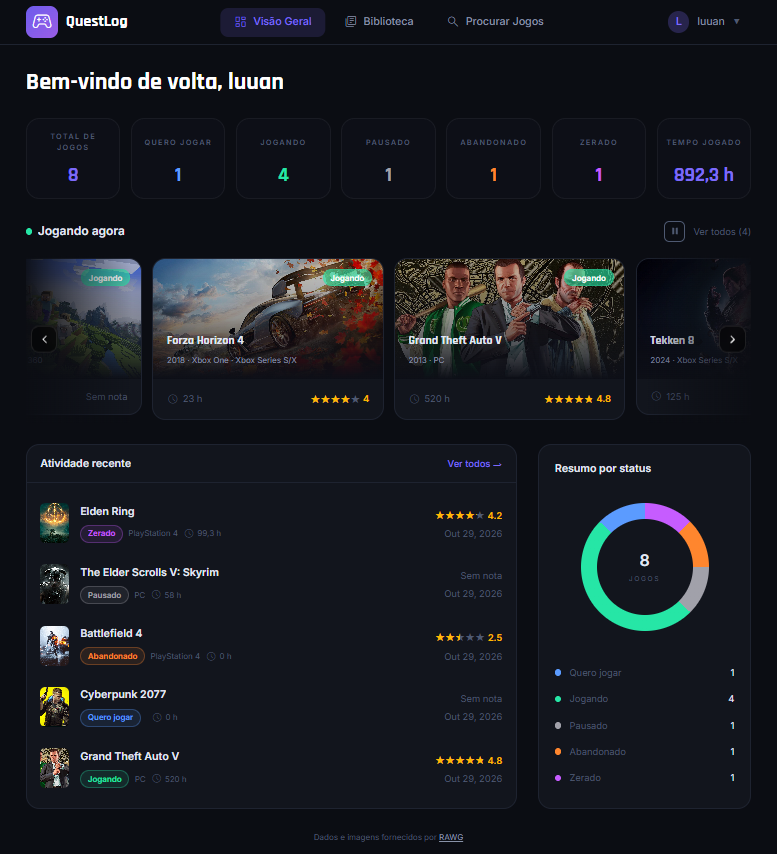
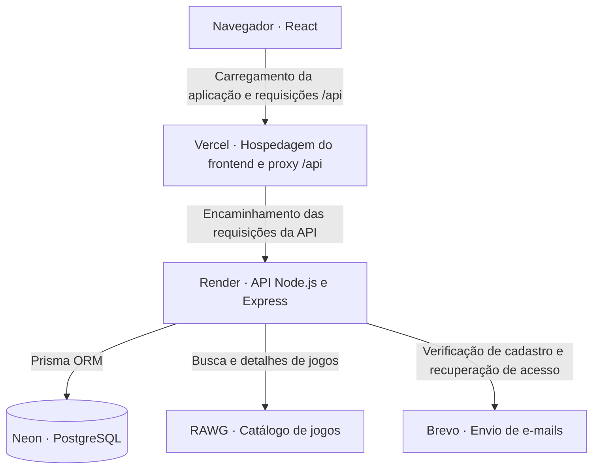

# QuestLog

[](https://quest-log-omega-jade.vercel.app/)
[](https://questlog-sandbox.onrender.com/docs/)
[](#catálogo-de-componentes)
[](https://deepwiki.com/luanlumertz/quest-log)

O QuestLog é uma aplicação web para organizar sua biblioteca de jogos e acompanhar sua experiência com cada título. Registre o progresso, o tempo jogado, as datas de início e conclusão e suas avaliações, reunindo em um só lugar o histórico da sua jornada nos jogos.

O projeto nasceu da minha dificuldade em encontrar uma ferramenta que combinasse esses registros da forma como eu gostaria de usar. Desenvolvi o QuestLog para atender a uma necessidade própria e aproveitei essa oportunidade para aprofundar meus conhecimentos em desenvolvimento full stack, testes automatizados, Docker e pipelines de integração e entrega contínuas.



## Sumário

- [Funcionalidades](#funcionalidades)
- [Tecnologias](#tecnologias)
- [Arquitetura](#arquitetura)
- [Documentação da API](#documentação-da-api)
- [Catálogo de componentes](#catálogo-de-componentes)
- [Guias técnicos](#guias-técnicos)
- [Como executar localmente](#como-executar-localmente)
- [Como executar os testes](#como-executar-os-testes)
- [Licença](#licença)

## Funcionalidades

- **Busca de jogos:** pesquisa paginada integrada à RAWG e consulta aos detalhes de cada título.
- **Biblioteca pessoal:** adição e remoção de jogos, seleção de plataformas e filtros por título e status.
- **Acompanhamento de progresso:** organização dos jogos nos status Quero jogar, Jogando, Pausado, Abandonado e Zerado.
- **Registro da experiência:** avaliações de 0 a 5, tempo jogado e datas de início e conclusão.
- **Dashboard:** total de jogos, distribuição por status, tempo total jogado, jogos em andamento e atividades recentes.
- **Cadastro e autenticação:** criação de conta com verificação por e-mail, login e renovação automática da sessão.
- **Gerenciamento da conta:** edição do nome de exibição, alteração de senha, recuperação de acesso por e-mail e exclusão da conta.

## Tecnologias

### Frontend

- **React e TypeScript:** construção da interface e tipagem do código.
- **Vite:** servidor de desenvolvimento e build da aplicação.
- **Tailwind CSS:** estilização e layouts responsivos.
- **React Router:** navegação entre páginas.
- **TanStack Query (React Query):** consultas à API, cache e sincronização dos dados.
- **React Hook Form e Zod:** gerenciamento e validação dos formulários.
- **Storybook:** catálogo interativo dos componentes, suas propriedades e estados.

### Backend

- **Node.js, Express e TypeScript:** desenvolvimento da API REST.
- **PostgreSQL e Prisma ORM:** persistência dos dados, consultas e migrations.
- **Zod:** validação dos dados recebidos pela API.
- **OpenAPI e Swagger UI:** documentação dos endpoints e execução de requisições pelo navegador.
- **JSON Web Token (JWT) e bcryptjs:** autenticação e hash de senhas.
- **Helmet, CORS e express-rate-limit:** cabeçalhos de segurança, configuração de acesso entre origens e limitação de requisições.
- **Pino:** logs estruturados em JSON na produção e saída legível com pino-pretty no desenvolvimento.
- **RAWG:** integração com o catálogo de jogos.
- **Brevo e Nodemailer:** envio de e-mails pela API da Brevo ou por SMTP, conforme o ambiente.

### Testes e qualidade

- **Vitest:** execução dos testes unitários e de integração, com relatórios de cobertura.
- **React Testing Library:** testes dos componentes e das interações na interface.
- **MSW:** simulação das respostas da API nos testes do frontend.
- **Supertest:** testes HTTP da API.
- **Playwright:** testes de ponta a ponta (E2E).
- **ESLint, Prettier, Husky e lint-staged:** análise estática, formatação e verificações antes dos commits.

### Infraestrutura e entrega

- **Docker Compose:** ambiente local com PostgreSQL, pgAdmin e Mailpit.
- **GitHub Actions:** pipeline de verificações automatizadas e deploy do backend.
- **Vercel e Render:** hospedagem do frontend e do backend, respectivamente.
- **Neon:** hospedagem do banco PostgreSQL em produção.

## Arquitetura

O projeto reúne o frontend e o backend no mesmo repositório. O frontend React executa no navegador e consome a API REST, responsável pelas regras de negócio, pela persistência dos dados e pelas integrações externas.

O diagrama abaixo representa o fluxo em produção:



Em produção, o navegador faz as chamadas à API pelo caminho `/api` no domínio do frontend. A Vercel encaminha essas requisições ao backend no Render e acrescenta um cabeçalho secreto validado pela API. Assim, a comunicação do navegador acontece pela mesma origem, e o segredo fica restrito à infraestrutura.

No backend, as responsabilidades são divididas entre **rotas e middlewares** (entrada, autenticação e validação), **controllers** (requisições e respostas HTTP), **services** (regras de negócio), **repositories** (acesso ao banco) e **integrations** (comunicação com serviços externos).

No frontend, as **páginas e os componentes** compõem a interface, os **hooks** organizam consultas e mutações com React Query, e os **services** centralizam as chamadas à API. O cliente HTTP também coordena a renovação da sessão e a repetição da requisição quando necessário.

No ambiente local, o Docker Compose disponibiliza PostgreSQL, pgAdmin e Mailpit. O Mailpit permite inspecionar os e-mails enviados por SMTP durante o desenvolvimento.

Consulte o [guia de arquitetura](docs/architecture.md) para conhecer as responsabilidades das camadas, os fluxos de requisições e as diferenças entre desenvolvimento, produção e sandbox.

## Documentação da API

A documentação usa **OpenAPI e Swagger UI** para apresentar endpoints, parâmetros, autenticação, respostas e modelos de dados (**Schemas**), além de permitir a execução de requisições pelo navegador. A seção **Comece por aqui** orienta o cadastro, a confirmação da conta e o login.

### Acesso público ao Swagger

[Explore e teste a API no Swagger](https://questlog-sandbox.onrender.com/docs/), sem instalar o projeto.

Os testes usam um **sandbox com API e banco próprios**, separado das contas e dos dados da aplicação principal. As operações são reais dentro desse ambiente: é possível criar, alterar e excluir seus dados de teste.

Para testar rotas protegidas, crie uma conta no sandbox pelas rotas de cadastro, confirme o código recebido por e-mail e faça login por `POST /auth/login`. O navegador gerencia os cookies automaticamente; não é necessário copiar tokens manualmente. Nas operações que exigem `X-QuestLog-Request`, mantenha o valor `true`. Se a sessão de acesso expirar, use `POST /auth/refresh` ou faça login novamente.

As contas do sandbox ficam elegíveis para exclusão automática após mais de **30 dias sem atividade**. O serviço pode demorar a responder no primeiro acesso após um período de inatividade.

### Acesso local ao Swagger

Siga o [guia de desenvolvimento](docs/development.md), incluindo a [configuração do frontend e dos cookies](docs/development.md#frontend-e-caminhos-dos-cookies), e mantenha backend e frontend em execução. Abra [http://localhost:5173/api/docs/](http://localhost:5173/api/docs/); o servidor `/api` usa o proxy local do Vite.

Use uma conta do ambiente local e consulte os códigos no [Mailpit](http://localhost:8025). As requisições são reais e usam o banco configurado no backend local. O [guia de autenticação](backend/docs/authentication.md#cookies-e-caminhos-por-ambiente) explica os caminhos dos cookies em cada ambiente.

## Catálogo de componentes

O **Storybook** apresenta os componentes de UI, autenticação, dashboard, jogos, biblioteca, perfil e navegação. Em **Docs**, consulte as descrições e propriedades; no **Canvas**, interaja com os exemplos e use **Controls** para experimentar as opções disponíveis. A página **Comece por aqui** explica como explorar o catálogo.

### Acesso público ao Storybook

**Link público:** [LINK] — substituir pelo endereço do catálogo após a publicação.

### Executar o Storybook localmente

Com Node.js e npm instalados, execute a partir da raiz do repositório:

```sh
cd frontend
npm ci
npm run storybook
```

Acesse [http://localhost:6006/](http://localhost:6006/). O catálogo usa **dados fictícios e operações simuladas**: não precisa de login, backend, banco ou Docker, e as interações não alteram os dados da aplicação. Os mesmos exemplos são usados localmente e no catálogo publicado.

Com as dependências do frontend instaladas, você também pode iniciá-lo pela raiz com `npm run storybook`.

Para gerar a versão estática, dentro de `frontend/`:

```sh
npm run build-storybook
```

O resultado é gerado em `frontend/storybook-static/`, pasta ignorada pelo Git.

## Guias técnicos

Consulte o [índice da documentação](docs/README.md) para encontrar as instruções disponíveis e acompanhar a organização dos guias de arquitetura, desenvolvimento, testes, deploy e detalhes do backend e do frontend.

## Como executar localmente

Você precisa de Node.js 24 com npm, Git, Docker com Compose em execução e uma chave da RAWG. O [guia de desenvolvimento local](docs/development.md) reúne a configuração completa, os comandos individuais e a resolução de problemas.

Clone o repositório e instale as ferramentas da raiz:

```sh
git clone https://github.com/luanlumertz/quest-log.git
cd quest-log
npm ci
```

Crie `.env`, `backend/.env` e `frontend/.env` a partir dos respectivos `.env.example`. Configure as credenciais locais do Docker, a conexão PostgreSQL, `JWT_SECRET` e `RAWG_API_KEY`, seguindo o [passo de configuração](docs/development.md#2-configurar-as-variáveis-de-ambiente). Para usar aplicação e Swagger juntos pelo Vite, esse passo também explica `VITE_API_URL=/api` e `AUTH_COOKIE_PATH_PREFIX=/api`.

Com os arquivos configurados, execute na raiz:

```sh
npm run setup
npm run db:prepare
npm run dev
```

Acesse a aplicação em [http://localhost:5173/](http://localhost:5173/). Cadastre-se e consulte o código de confirmação no [Mailpit](http://localhost:8025/). Para incluir o Storybook no grupo, use `npm run dev:full` no lugar de `npm run dev`.

Você também pode iniciar cada aplicação com `npm run dev` diretamente em `backend/` e `frontend/`, em terminais separados e com a infraestrutura disponível. Veja as [alternativas de execução](docs/development.md#executar-cada-parte-separadamente).

Para encerrar os servidores do grupo, use `Ctrl+C`; para parar a infraestrutura preservando os dados, execute `npm run infra:stop`. O [guia](docs/development.md#logs-e-encerramento) detalha o comportamento dos processos e containers.

## Como executar os testes

O [guia de testes](docs/testing.md) reúne os arquivos de ambiente, a preparação dos bancos isolados, os comandos por suíte e a investigação de falhas. Prepare o ambiente correspondente antes de executar os comandos abaixo, a partir da raiz:

| Suíte          | Comando                      | Preparação                                                                           |
| -------------- | ---------------------------- | ------------------------------------------------------------------------------------ |
| Scripts locais | `npm run test:dev`           | Dependências da raiz; sem Docker ou banco.                                           |
| Backend        | `npm test --prefix backend`  | `backend/.env.test`, Prisma Client e migrations em `quest_log_test` para integração. |
| Frontend       | `npm test --prefix frontend` | Dependências do frontend; respostas da API simuladas.                                |
| E2E            | `npx playwright test`        | Arquivos `.env.e2e`, migrations em `quest_log_e2e`, PostgreSQL, Mailpit e Chromium.  |

Para cobertura, execute `npm run test:coverage` dentro de `backend/` ou `frontend/`. As duas configurações exigem no mínimo **90%** em statements, branches, functions e lines.

A CI verifica formatação, lint, tipos, builds, cobertura e E2E. O job do frontend também gera o Storybook. Os relatórios disponíveis no GitHub Actions e o papel de cada verificação estão descritos no [guia](docs/testing.md#verificações-locais-e-ci).

## Licença

Este projeto está disponível sob a [licença MIT](LICENSE).
