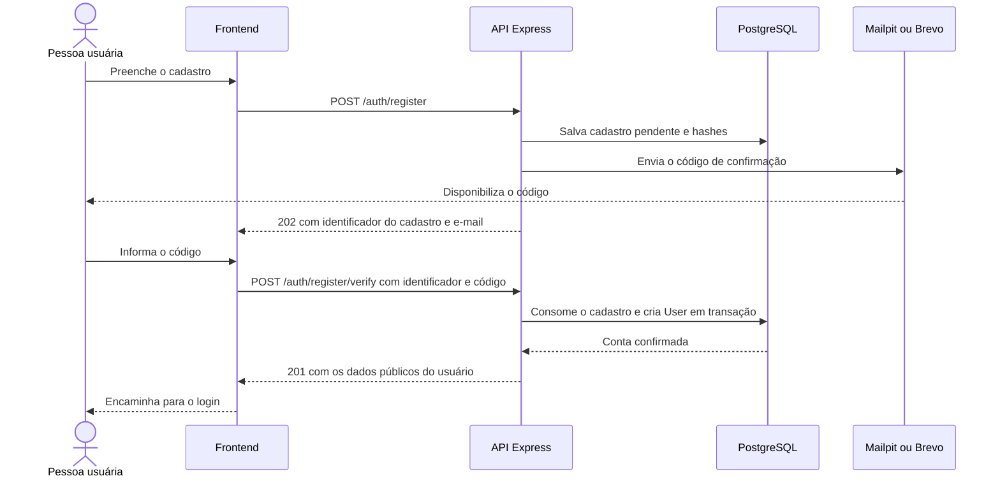
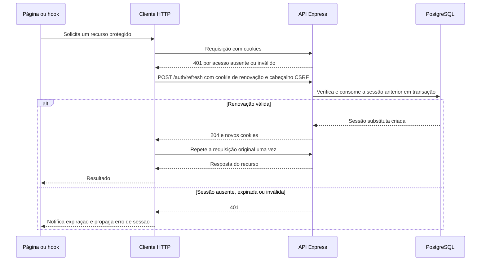
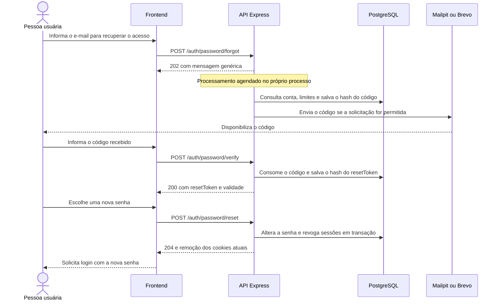

# Autenticação e sessão

[Voltar ao índice dos guias](../../docs/README.md) · [Arquitetura geral](../../docs/architecture.md) · [Banco de dados](database.md)

A autenticação do QuestLog usa um token de acesso JWT e um token de renovação enviados em cookies `HttpOnly`. O backend verifica a sessão nas rotas protegidas, e o frontend coordena a renovação quando uma chamada recebe `401`.

Este guia explica os fluxos e suas responsabilidades. Os corpos completos, parâmetros, respostas e exemplos de cada endpoint estão no [OpenAPI e Swagger UI](../../README.md#documentação-da-api). As rotas mencionadas aqui são as do Express, sem o prefixo `/api` acrescentado pelos proxies.

## Dados usados em cada etapa

| Dado                    | Finalidade                                                                  | Onde fica                                                             |
| ----------------------- | --------------------------------------------------------------------------- | --------------------------------------------------------------------- |
| `pendingRegistrationId` | Identificar uma tentativa de cadastro ainda não confirmada.                 | Resposta de cadastro e estado da etapa no frontend.                   |
| Código de seis dígitos  | Confirmar o cadastro ou autorizar a recuperação de senha.                   | E-mail recebido pela pessoa; o banco guarda o hash.                   |
| `accessToken`           | Autenticar chamadas protegidas, com `userId`, `sessionVersion` e expiração. | Cookie `HttpOnly`; não há tabela própria para esse JWT.               |
| `refreshToken`          | Obter novos tokens de sessão sem informar a senha novamente.                | Cookie `HttpOnly`; o banco guarda o hash em `RefreshSession`.         |
| `resetToken`            | Autorizar uma redefinição de senha após confirmar o código de recuperação.  | Resposta de verificação e memória do frontend; o banco guarda o hash. |

Os tokens de sessão não são devolvidos no JSON do login: o controller os grava em cookies e responde com `id`, `name` e `email` do usuário. O `resetToken` pertence a outro fluxo e é devolvido em JSON por `POST /auth/password/verify`.

Senhas e códigos usam hash com bcrypt. Os tokens aleatórios de renovação e redefinição usam hashes SHA-256 para consulta no banco. Veja os [utilitários de autenticação](../src/lib) e o [guia do banco](database.md#contas-e-dados-temporários).

## Cadastro e confirmação do e-mail

1. `POST /auth/register` recebe nome, e-mail e senha, cria ou substitui uma tentativa em `PendingRegistration` e envia o código por e-mail.
2. A resposta `202` informa `pendingRegistrationId` e e-mail. A conta confirmada ainda não existe.
3. `POST /auth/register/verify` recebe esse identificador e o código. A API confere validade e tentativas, consome o cadastro pendente e cria `User` em transação.
4. A resposta `201` confirma a criação. A pessoa faz login separadamente por `POST /auth/login`.



Um e-mail já associado a `User` retorna conflito. Se existir somente uma tentativa pendente, um novo cadastro substitui seus dados e identificador, invalidando a tentativa anterior.

O cadastro pendente dura 30 minutos. O código dura até 10 minutos, respeitando o prazo restante do cadastro. `POST /auth/register/resend` gera outro código após o intervalo mínimo de 60 segundos; o reenvio zera as tentativas do código e mantém o prazo final do cadastro. Após cinco códigos incorretos, aquele código não pode mais confirmar a conta.

O envio do e-mail de cadastro é aguardado antes da resposta de sucesso. Em caso de falha no envio, o backend tenta invalidar o código e retorna `503`. O Mailpit permite consultar as mensagens no desenvolvimento; produção e sandbox usam a Brevo conforme a configuração do ambiente.

O [RegistrationProvider](../../frontend/src/contexts/RegistrationProvider.tsx) mantém a etapa atual. O [armazenamento de cadastro](../../frontend/src/lib/registrationSession.ts) salva no `sessionStorage` apenas identificador, e-mail e prazos da interface. A senha e os dados completos do formulário permanecem em memória. Os prazos locais orientam a tela; a validade real é conferida pelo backend.

Implementação: [auth.service.ts](../src/services/auth.service.ts), [auth.helpers.ts](../src/services/auth.helpers.ts) e [pendingRegistration.repository.ts](../src/repositories/pendingRegistration.repository.ts).

## Login e consulta da sessão

`POST /auth/login` consulta a conta pelo e-mail normalizado e compara a senha com o hash salvo. E-mail inexistente e senha incorreta recebem a mesma mensagem de credenciais inválidas.

No sucesso, a API gera o JWT de acesso e um token aleatório de renovação. O hash deste último é persistido em `RefreshSession`. A resposta grava os dois cookies, e o frontend coloca os dados públicos do usuário no contexto de autenticação.

Uma rota protegida passa pelo [middleware de autenticação](../src/middlewares/auth.middleware.ts), que:

1. Lê o cookie `accessToken`.
2. Verifica a assinatura, a expiração e os campos esperados do JWT.
3. Consulta o usuário e compara `sessionVersion` com a versão no token.
4. Disponibiliza `req.userId` para a operação, se a sessão for válida.

Essa consulta ao banco permite rejeitar tokens de uma conta excluída ou de uma versão anterior da sessão. `GET /auth/me` devolve os dados públicos do usuário; a rota não renova a sessão por conta própria.

Ao iniciar a aplicação, o [AuthProvider](../../frontend/src/contexts/AuthProvider.tsx) consulta `/auth/me` e distingue carregamento, autenticação, ausência de sessão e falha na consulta. Uma falha de rede oferece uma nova tentativa na interface, sem ser tratada automaticamente como credenciais inválidas. As [rotas protegidas](../../frontend/src/routes/ProtectedRoute.tsx) usam esse estado para exibir o carregamento, o erro ou encaminhar ao login; a autorização das requisições continua sendo conferida pela API.

## Renovação automática na aplicação

O acesso dura 15 minutos. A sessão de renovação dura sete dias; cada renovação bem-sucedida consome o registro anterior e cria uma sessão substituta com novo token e novo prazo de sete dias.

O [cliente HTTP do frontend](../../frontend/src/services/api.ts) implementa este fluxo:



Se várias chamadas na mesma instância do cliente HTTP precisarem renovar ao mesmo tempo, elas compartilham uma promessa de renovação. Isso evita disparar um refresh para cada chamada simultânea naquela página. O mecanismo não coordena abas independentes.

Login, logout, cadastro e recuperação de senha ficam fora dessa tentativa automática. Nas chamadas elegíveis, a requisição original é repetida no máximo uma vez. Se continuar recebendo `401`, ou se o refresh retornar `400`, `401` ou `403`, o cliente emite `auth:session-expired`; o `AuthProvider` limpa o cache do React Query e o usuário do contexto.

Falhas de rede, respostas `5xx` e limites `429` na renovação são propagados como falhas da operação, sem emitir esse evento de expiração. A API não depende de um temporizador no navegador: a renovação acontece em resposta a uma chamada que precise dela.

A rotação é coordenada pelo [serviço de renovação](../src/services/refreshSession.service.ts) e pelo [repositório de sessões](../src/repositories/refreshSession.repository.ts), com bloqueio da linha do usuário durante a transação. Um token já consumido não pode criar outra sessão substituta.

## Cookies e caminhos por ambiente

Os cookies usam `HttpOnly`, `SameSite=Lax` e `Secure` quando `NODE_ENV=production`, incluindo o sandbox. O código não define `Domain`; o navegador os associa ao host da resposta. O frontend envia `credentials: "include"` nas chamadas e não precisa ler ou copiar os valores desses cookies.

O caminho determina em quais requisições o navegador envia cada cookie:

| Cenário                              | Prefixo dos cookies                 | Caminho do acesso | Caminho da renovação |
| ------------------------------------ | ----------------------------------- | ----------------- | -------------------- |
| API local direta                     | Vazio, padrão local.                | `/`               | `/auth`              |
| Aplicação e Swagger locais pelo Vite | `/api`, configurado explicitamente. | `/api`            | `/api/auth`          |
| Produção pela Vercel                 | `/api`, padrão de produção.         | `/api`            | `/api/auth`          |
| Sandbox direto                       | Vazio, obrigatório nesse ambiente.  | `/`               | `/auth`              |

Na produção, o navegador chama `/api/auth/refresh`, mas o Express recebe `/auth/refresh` após o encaminhamento. O caminho do cookie acompanha a URL vista pelo navegador. A configuração está em [authCookies.ts](../src/lib/authCookies.ts).

### Desenvolvimento com Swagger e aplicação no mesmo caminho

Para usar o Swagger em `http://localhost:5173/api/docs/`, configure no `backend/.env`:

```dotenv
AUTH_COOKIE_PATH_PREFIX=/api
```

Nesse fluxo, configure também no `frontend/.env`:

```dotenv
VITE_API_URL=/api
```

Assim, aplicação e Swagger enviam login, refresh e logout pelo proxy do Vite. Reinicie os servidores e faça login novamente após alterar a configuração. Se o cookie de renovação tiver caminho `/api/auth`, uma chamada direta para `http://localhost:3000/auth/refresh` não corresponde a esse caminho, e o navegador não o envia nessa chamada.

Para usar somente a API local direta com `VITE_API_URL=http://localhost:3000`, mantenha o prefixo dos cookies vazio. No sandbox, deixe `AUTH_COOKIE_PATH_PREFIX` sem definição; o código rejeita `/api` nesse ambiente.

## Origem, CSRF e limites de requisições

Os middlewares de segurança são aplicados antes das rotas, inclusive nas operações públicas como login e cadastro. Cada proteção tem uma responsabilidade:

| Proteção                   | Comportamento no projeto                                                                                                                   |
| -------------------------- | ------------------------------------------------------------------------------------------------------------------------------------------ |
| Autenticação               | Identifica o usuário pelo cookie e confere sua sessão nas rotas protegidas.                                                                |
| CORS                       | Permite ao frontend da origem configurada ler respostas pelo navegador com credenciais.                                                    |
| CSRF                       | Nas operações diferentes de `GET`, `HEAD` e `OPTIONS`, exige a origem confiável e `X-QuestLog-Request: true`. Se houver corpo, exige JSON. |
| Cabeçalho privado do proxy | Na instalação de produção, exige `X-QuestLog-Origin-Secret`, acrescentado pela Vercel e comparado com `ORIGIN_SECRET`.                     |
| Limites de requisições     | Restringem tentativas por IP ou usuário, conforme a rota.                                                                                  |

A origem confiável vem de `FRONTEND_URL`. O [middleware CSRF](../src/middlewares/csrf.middleware.ts) usa `Origin` e, somente se ele estiver ausente, tenta obter a origem de `Referer`. Um `Origin` inválido não é substituído por um `Referer` válido. O frontend acrescenta o cabeçalho CSRF automaticamente nas operações de escrita.

O [segredo do proxy](../src/middlewares/origin.middleware.ts) pertence à infraestrutura da produção. Ele não identifica o usuário e não é enviado pelo código React. No sandbox, esse segredo fica sem configuração, pois as chamadas são diretas; autenticação, CSRF e limites continuam ativos. `FRONTEND_URL` aponta para a origem do próprio serviço sandbox. O [guia de arquitetura](../../docs/architecture.md) apresenta os dois caminhos.

Os limites por IP dependem do endereço resolvido pelo Express; `TRUST_PROXY_HOPS` precisa corresponder à cadeia de proxies de cada instalação. Não existe um único valor que deva ser copiado entre produção, sandbox e acesso local direto.

Alguns limites atuais, definidos em [rateLimit.middleware.ts](../src/middlewares/rateLimit.middleware.ts):

| Operação                                         | Limite                                                                                   |
| ------------------------------------------------ | ---------------------------------------------------------------------------------------- |
| Login                                            | Dez tentativas por IP em 15 minutos; respostas bem-sucedidas não permanecem no contador. |
| Renovação                                        | Cem requisições por IP em cinco minutos.                                                 |
| Início do cadastro                               | Dez requisições por IP em uma hora.                                                      |
| Confirmação do cadastro ou código de recuperação | Trinta requisições por IP em 15 minutos, em contadores separados.                        |
| Reenvio do cadastro                              | Dez requisições por IP em 15 minutos.                                                    |
| Solicitação e reenvio de recuperação             | Dez requisições por IP em uma hora, compartilhando o contador.                           |
| Redefinição com token                            | Dez requisições por IP em 15 minutos.                                                    |
| Troca autenticada de senha                       | Trinta requisições por IP e dez por usuário em 15 minutos.                               |

Esses contadores se somam aos controles persistidos de código e reenvio. Os limitadores usam o armazenamento em memória padrão da instância da API. Na recuperação, há também um intervalo de 60 segundos e um limite de dez envios por conta em uma janela de uma hora, controlados no banco.

## Recuperação de acesso

O fluxo de recuperação não exige uma sessão autenticada:

1. `POST /auth/password/forgot` recebe o e-mail e responde `202` com mensagem genérica. `POST /auth/password/resend` usa o mesmo processamento e contador por IP.
2. O backend agenda o processamento no próprio processo, consulta a conta e os limites persistidos e, quando permitido, envia o código. A resposta HTTP não aguarda essa consulta nem o envio; receber `202` não confirma que um e-mail foi entregue.
3. `POST /auth/password/verify` recebe e-mail e código. A verificação válida consome o código e devolve `resetToken` e `expiresIn: 600`.
4. `POST /auth/password/reset` recebe o token e a nova senha. A API consome a autorização, altera o hash da senha, incrementa `sessionVersion` e remove as sessões de renovação e os dados de recuperação em transação.
5. A resposta `204` limpa os cookies do navegador que fez a operação. O frontend limpa seu estado e encaminha para o login com a nova senha.



O diagrama representa o caminho bem-sucedido. A solicitação inicial mantém a mesma mensagem para conta inexistente, intervalo de reenvio ou limite por conta. Códigos inválidos, expirados ou consumidos também usam uma mensagem genérica. A comparação de código usa um hash substituto quando não há um código ativo.

O código dura 10 minutos e permite até cinco tentativas incorretas. A autorização de redefinição dura outros 10 minutos após sua emissão. Gerar outro código substitui o anterior e invalida a autorização de redefinição que estivesse salva para aquela conta.

O [PasswordRecoveryProvider](../../frontend/src/contexts/PasswordRecoveryProvider.tsx) mantém `resetToken` somente em memória. No [sessionStorage da recuperação](../../frontend/src/lib/passwordRecoverySession.ts), ficam apenas e-mail e prazo de reenvio. Recarregar a página perde a autorização em memória e exige confirmar um novo código para continuar.

O envio agendado não usa uma fila persistente externa. Falhas são registradas nos logs, e o backend tenta invalidar o código quando seu envio falha. Depois de uma alteração de senha, o aviso por e-mail também é enviado; uma falha nesse aviso é registrada sem desfazer a senha já alterada.

Implementação: [password.service.ts](../src/services/password.service.ts), [password.helpers.ts](../src/services/password.helpers.ts) e [passwordRecovery.repository.ts](../src/repositories/passwordRecovery.repository.ts).

## Troca de senha, logout e exclusão da conta

### Troca autenticada de senha

`PATCH /auth/me/password` exige uma sessão válida e a senha atual. A nova senha deve ser diferente da anterior. A operação incrementa `sessionVersion`, remove sessões antigas e dados de recuperação e cria uma sessão substituta na mesma transação.

No sucesso, a resposta `204` grava novos cookies: a pessoa continua conectada no navegador que fez a troca, e as credenciais das outras sessões deixam de ser válidas. O [formulário do perfil](../../frontend/src/components/profile/ChangePasswordSection.tsx) apresenta o sucesso sem encaminhar ao login. Os outros navegadores percebem a invalidação ao fazer novas chamadas protegidas.

As regras para novas senhas estão no [schema de autenticação](../src/schemas/auth.schema.ts): entre 8 e 70 caracteres, no máximo 72 bytes em UTF-8 e conteúdo diferente de apenas espaços. A senha é comparada e armazenada com seus espaços; não é aplicado `trim` ao valor usado no hash. A confirmação da nova senha é uma validação do formulário; a API recebe o campo `password`.

### Logout

`POST /auth/logout` consome o cookie de renovação apresentado para remover aquela sessão e limpa os cookies de acesso e renovação do navegador. A rota não exige um JWT de acesso válido; pode ser usada mesmo quando ele já expirou. A proteção CSRF continua sendo exigida.

O logout não incrementa `sessionVersion` e não remove todas as sessões da conta. Um JWT de acesso previamente copiado pode continuar válido até sua expiração; o navegador que fez logout perde seus cookies. Na aplicação, `AuthProvider.signOut` também limpa o usuário e o cache após o sucesso. Falhas de rede ou do servidor são apresentadas sem afirmar que a saída foi concluída.

### Perfil e exclusão

`PATCH /auth/me` altera o nome de exibição e atualiza o usuário no contexto do frontend. A edição do perfil não inclui alteração de e-mail.

`DELETE /auth/me` exclui a conta autenticada e limpa os cookies na resposta `204`. As entradas pessoais, suas plataformas selecionadas, as sessões e a recuperação de senha são removidas pelas cascatas do banco. O frontend limpa o cache e o usuário. Tokens de acesso dessa conta deixam de passar na consulta do usuário feita pelo middleware. Os dados compartilhados do catálogo permanecem, conforme o [guia do banco](database.md#exclusões-e-retenção).

## Uso pelo Swagger

No Swagger, execute cadastro, confirmação e login no ambiente que estiver aberto. Depois do login, o navegador envia os cookies nas chamadas seguintes; não é necessário preencher tokens manualmente em **Authorize**. Os cadeados nas operações indicam a exigência de autenticação, sem representar uma consulta em tempo real ao estado da sessão.

Nas operações de escrita, mantenha `X-QuestLog-Request` como `true`. Para experimentar uma rota protegida sem sessão, execute `POST /auth/logout` antes. Se o acesso expirar, execute `POST /auth/refresh` ou faça login novamente: o Swagger não incorpora o cliente HTTP do React e não faz sua renovação automática.

O Swagger local usa os dados locais configurados no backend; o [Swagger público](https://questlog-sandbox.onrender.com/docs/) usa contas e banco próprios do sandbox. Fazer login na aplicação principal não autentica a conta do sandbox. As diferenças de caminhos e cookies estão na [configuração por ambiente](#cookies-e-caminhos-por-ambiente).

## Referências de implementação

| Parte                                     | Arquivos                                                                                                                                                                       |
| ----------------------------------------- | ------------------------------------------------------------------------------------------------------------------------------------------------------------------------------ |
| Endpoints e respostas HTTP                | [Rotas](../src/routes/auth.router.ts), [controller de autenticação](../src/controllers/auth.controller.ts) e [controller de senha](../src/controllers/password.controller.ts). |
| Prazos e limites persistidos              | [Constantes](../src/constants/auth.ts) e [repositório de recuperação](../src/repositories/passwordRecovery.repository.ts).                                                     |
| Emissão e leitura dos cookies             | [authCookies.ts](../src/lib/authCookies.ts).                                                                                                                                   |
| Verificação do JWT e do usuário           | [jwt.ts](../src/lib/jwt.ts) e [auth.middleware.ts](../src/middlewares/auth.middleware.ts).                                                                                     |
| Renovação e estado da sessão na interface | [Cliente HTTP](../../frontend/src/services/api.ts) e [AuthProvider](../../frontend/src/contexts/AuthProvider.tsx).                                                             |
