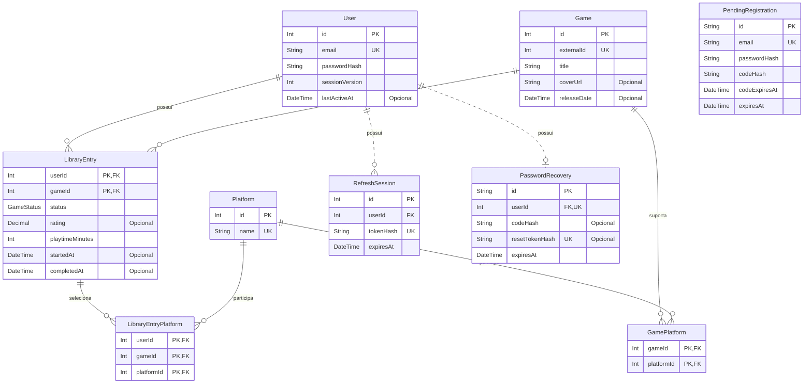

# Banco de dados

[Voltar ao índice dos guias](../../docs/README.md) · [Arquitetura geral](../../docs/architecture.md)

O QuestLog usa PostgreSQL e Prisma para persistir contas, sessões, jogos e bibliotecas pessoais. A estrutura atual está em [schema.prisma](../prisma/schema.prisma), e sua evolução está registrada nas [migrations](../prisma/migrations).

## Modelo de dados

O diagrama resume os modelos, seus principais campos e relacionamentos. **PK** indica a chave primária, **FK** uma chave estrangeira e **UK** uma restrição de unicidade. Nas chaves compostas, a combinação dos campos identifica o registro; cada campo isolado pode se repetir.



Um usuário pode ter zero ou várias entradas na biblioteca e sessões de renovação, além de no máximo uma recuperação de senha. Cada entrada pertence a um usuário e a um jogo. `PendingRegistration` aparece separado porque ainda representa uma tentativa de cadastro, sem vínculo por chave estrangeira com `User`.

Em `LibraryEntryPlatform`, a chave estrangeira formada por `(userId, gameId)` aponta para uma entrada existente da biblioteca. A seleção de plataformas disponíveis para aquele jogo também é validada pelo serviço da aplicação.

### Responsabilidade de cada modelo

| Modelo                 | Dados e finalidade                                                                                                          |
| ---------------------- | --------------------------------------------------------------------------------------------------------------------------- |
| `User`                 | Conta confirmada: nome, e-mail, hash da senha, versão da sessão, datas de criação e atualização e atividade no sandbox.     |
| `Game`                 | Dados compartilhados do catálogo local: identificador da RAWG, título, capa e lançamento.                                   |
| `Platform`             | Plataforma identificada por um nome único, reutilizada nos vínculos com jogos e bibliotecas.                                |
| `GamePlatform`         | Plataformas disponíveis para um jogo do catálogo local.                                                                     |
| `LibraryEntry`         | Registro pessoal do jogo: status, nota, minutos jogados e datas de início e conclusão.                                      |
| `LibraryEntryPlatform` | Plataformas que o usuário selecionou para aquele registro da biblioteca.                                                    |
| `RefreshSession`       | Hash do token de renovação, usuário e validade da sessão.                                                                   |
| `PendingRegistration`  | Dados do cadastro ainda não confirmado, hash do código, validades, tentativas e controle de reenvio.                        |
| `PasswordRecovery`     | Recuperação de acesso de uma conta: hashes do código e do token de redefinição, validades, tentativas e controle de envios. |

## Catálogo compartilhado e biblioteca pessoal

`Game` responde **qual é o jogo**. `LibraryEntry` responde **como uma pessoa está jogando esse título**.

Por exemplo, duas pessoas podem adicionar o mesmo jogo da RAWG. Existe um registro em `Game`, identificado por `externalId`, e uma entrada em `LibraryEntry` para cada pessoa. Uma pode ter zerado o jogo e dado nota 4,5; a outra pode estar jogando, sem nota e com outro tempo registrado.

Os identificadores têm funções diferentes:

- `Game.externalId` é o ID da RAWG, usado na busca, nos detalhes externos e na adição à biblioteca.
- `Game.id` é o ID interno do catálogo local, referenciado por `LibraryEntry.gameId` e pelas rotas de um item já adicionado à biblioteca.
- `(LibraryEntry.userId, LibraryEntry.gameId)` é a chave primária composta que impede a repetição do mesmo jogo na biblioteca da mesma pessoa.

As plataformas seguem uma separação parecida: `GamePlatform` registra as opções do jogo, enquanto `LibraryEntryPlatform` registra a seleção pessoal. A chave `(userId, gameId, platformId)` impede repetir uma plataforma na mesma entrada.

O [serviço de obtenção do jogo](../src/services/library-game.service.ts) consulta o catálogo local antes de importar dados da RAWG. As buscas e os detalhes externos continuam sendo consultados pela integração; o banco guarda os dados necessários para manter as bibliotecas.

As estatísticas do dashboard são calculadas a partir de `LibraryEntry`, por usuário, com agrupamento por status e soma dos minutos. A atividade recente é uma consulta às entradas ordenadas por `updatedAt`; não existe uma tabela separada de eventos para esse histórico. Veja o [repositório do dashboard](../src/repositories/dashboard.repository.ts).

## Progresso, notas, tempo e datas

### Status

`GameStatus` é um enum do PostgreSQL definido pelo Prisma:

| Valor persistido | Nome na interface |
| ---------------- | ----------------- |
| `WANT_TO_PLAY`   | Quero jogar       |
| `PLAYING`        | Jogando           |
| `PAUSED`         | Pausado           |
| `COMPLETED`      | Zerado            |
| `ABANDONED`      | Abandonado        |

O padrão de uma entrada é `WANT_TO_PLAY`. As datas são independentes do status: a adição inicial grava início e conclusão como `null`, e mudar o status não preenche essas datas automaticamente.

### Campos do registro pessoal

| Campo             | Persistência                 | Regra aplicada pela API                                                                              |
| ----------------- | ---------------------------- | ---------------------------------------------------------------------------------------------------- |
| `rating`          | `Decimal(2,1)`, opcional.    | De 0 a 5, em incrementos de 0,1. `null` significa sem nota; zero é uma nota válida.                  |
| `playtimeMinutes` | Inteiro, padrão `0`.         | Inteiro não negativo. A interface apresenta e recebe horas, convertidas para minutos antes do envio. |
| `startedAt`       | `DateTime`, opcional.        | Data válida, normalizada para meia-noite UTC e sem dia futuro.                                       |
| `completedAt`     | `DateTime`, opcional.        | Mesma normalização; quando as duas datas existem, a conclusão não pode ser anterior ao início.       |
| `createdAt`       | `DateTime`, padrão `now()`.  | Registra a criação da entrada.                                                                       |
| `updatedAt`       | `DateTime` com `@updatedAt`. | Mantido pelo Prisma quando há atualização dos campos da entrada.                                     |

Guardar tempo em minutos permite somar e comparar inteiros sem depender da formatação de horas. Por exemplo, 90 minutos podem aparecer como `1,5 h`, mas o valor persistido continua sendo `90`. A [conversão do formulário](../../frontend/src/components/library/details/libraryGameDetailsForm.utils.ts) e a [formatação do tempo](../../frontend/src/utils/formatPlayTime.ts) ficam no frontend.

A nota usa um tipo decimal com uma casa. Nas respostas de consulta e atualização da biblioteca, os [helpers](../src/services/library.helpers.ts) convertem o valor do Prisma para um número JSON. As datas de início e conclusão representam dias escolhidos pela pessoa; os mesmos helpers fazem a normalização em UTC e comparam o estado final, incluindo valores que já estavam salvos.

### O que é garantido pelo banco e pela aplicação

O banco garante tipos, obrigatoriedade dos campos, valores do enum, chaves primárias, unicidade e integridade das referências. Os intervalos de nota e tempo, a coerência das datas e a escolha de plataformas compatíveis são verificados nos [schemas Zod](../src/schemas/library.schema.ts) e nos [serviços da biblioteca](../src/services/library.service.ts).

As migrations atuais não criam restrições SQL `CHECK` para esses intervalos e comparações. Assim, uma gravação direta no banco não passa pelas mesmas validações da API. A chave estrangeira de `LibraryEntryPlatform` também não verifica, sozinha, se a plataforma pertence a `GamePlatform`; essa regra está no [serviço de plataformas](../src/services/library-platform.service.ts).

## Contas e dados temporários

Os fluxos que criam, consomem e invalidam esses registros estão no [guia de autenticação e sessão](authentication.md).

`User.email` é único. A senha é armazenada em `passwordHash`; o código de confirmação de cadastro é armazenado em `PendingRegistration.codeHash`. Senhas e códigos usam hash com bcrypt. Os tokens de renovação e de redefinição de senha têm hashes SHA-256 persistidos em `RefreshSession.tokenHash` e `PasswordRecovery.resetTokenHash`.

O JWT de acesso não possui uma tabela própria. `User.sessionVersion` permite invalidar tokens de versões anteriores da sessão. A troca e a recuperação de senha incrementam essa versão e removem sessões de renovação anteriores; a troca autenticada também grava uma sessão substituta na mesma transação.

Os registros temporários têm ciclos diferentes:

- **Cadastro pendente:** mantém os dados até a confirmação. A confirmação válida consome o registro pendente e cria `User` na mesma transação. `codeExpiresAt` controla a validade do código, e `expiresAt`, a validade da tentativa de cadastro.
- **Sessão de renovação:** um usuário pode ter várias. Na renovação, o registro anterior é consumido e um novo hash é salvo em transação; a validade é verificada pelo serviço.
- **Recuperação de senha:** `userId` único permite no máximo um registro por conta. O código autoriza a criação de um token temporário de redefinição. Validade do código, validade do token e prazo de retenção do registro ficam em campos próprios; o registro também mantém os limites de envio.

As tarefas de limpeza de [cadastros pendentes](../src/jobs/cleanupPendingRegistrations.ts) e [recuperações de senha](../src/jobs/cleanupPasswordRecoveries.ts) executam ao iniciar o servidor e a cada 30 minutos, removendo registros cujo `expiresAt` venceu. A expiração é conferida nos fluxos da API mesmo antes da remoção física desses registros.

## Unicidade, índices e transações

Além das chaves primárias, o schema declara unicidade para `User.email`, `Game.externalId`, `Platform.name`, `RefreshSession.tokenHash`, `PendingRegistration.email`, `PasswordRecovery.userId` e `PasswordRecovery.resetTokenHash`. As chaves compostas de `GamePlatform`, `LibraryEntry` e `LibraryEntryPlatform` impedem vínculos duplicados.

Há índices adicionais em `User.lastActiveAt`, usado no controle de inatividade do sandbox, e em `PasswordRecovery.expiresAt`, usado na limpeza de recuperações expiradas. As chaves primárias e restrições de unicidade também possuem índices no PostgreSQL.

As operações com várias gravações usam transações, por exemplo:

| Operação                            | Gravações agrupadas                                                                                                 | Referência                                                                                 |
| ----------------------------------- | ------------------------------------------------------------------------------------------------------------------- | ------------------------------------------------------------------------------------------ |
| Importar jogo                       | Criação do jogo, obtenção das plataformas e vínculos do catálogo.                                                   | [game.repository.ts](../src/repositories/game.repository.ts)                               |
| Adicionar ou editar entrada pessoal | Criação da entrada com suas plataformas; na edição, alteração dos campos e substituição das plataformas informadas. | [library.service.ts](../src/services/library.service.ts)                                   |
| Confirmar cadastro                  | Consumo do cadastro pendente e criação da conta confirmada.                                                         | [pendingRegistration.repository.ts](../src/repositories/pendingRegistration.repository.ts) |
| Renovar sessão                      | Consumo da sessão anterior e criação da substituta.                                                                 | [refreshSession.repository.ts](../src/repositories/refreshSession.repository.ts)           |
| Trocar ou redefinir senha           | Alteração da senha e versão da sessão, revogação de sessões e tratamento dos dados de recuperação.                  | [passwordRecovery.repository.ts](../src/repositories/passwordRecovery.repository.ts)       |

Na importação do catálogo, as restrições únicas e `skipDuplicates` permitem reutilizar jogos e plataformas que outra requisição tenha acabado de criar. Nas operações de sessão e senha, o [repositório de sessão](../src/repositories/session.repository.ts) bloqueia a linha do usuário durante a transação para coordenar alterações concorrentes.

A importação do jogo e a criação da entrada pessoal usam transações separadas. Um jogo importado pode permanecer no catálogo mesmo que a criação posterior da entrada falhe; os dados compartilhados do jogo não pertencem exclusivamente àquela biblioteca.

## Exclusões e retenção

As relações com `onDelete: Cascade` definem estas remoções:

| Registro excluído | Registros removidos em cascata                                                                    |
| ----------------- | ------------------------------------------------------------------------------------------------- |
| `User`            | Suas entradas em `LibraryEntry`, sessões em `RefreshSession` e recuperação em `PasswordRecovery`. |
| `LibraryEntry`    | Suas seleções em `LibraryEntryPlatform`.                                                          |

Por consequência, excluir uma conta também remove as plataformas selecionadas nas entradas pessoais. Os registros compartilhados em `Game`, `Platform` e `GamePlatform` permanecem. As referências a jogos e plataformas usam restrições de exclusão quando ainda existem vínculos dependentes.

No sandbox, `lastActiveAt` é preenchido na criação da conta e atualizado no login, na renovação e em requisições autenticadas. O [workflow diário](../../.github/workflows/sandbox-cleanup.yml) remove contas criadas há mais de 30 dias e cuja atividade seja anterior ao limite, ou esteja ausente. Essa exclusão usa as mesmas cascatas do banco. A rotina valida `APP_ENV=sandbox` e a conexão real com `quest_log_sandbox`; a política não é aplicada às contas de produção.

## Conexões e ambientes

| Ambiente              | Banco                                                                 | Uso                                          |
| --------------------- | --------------------------------------------------------------------- | -------------------------------------------- |
| Desenvolvimento       | `quest_log`, no PostgreSQL do Docker.                                 | Uso manual da aplicação e Swagger local.     |
| Integração do backend | `quest_log_test`, em PostgreSQL isolado dos dados de desenvolvimento. | Testes que criam e limpam registros.         |
| E2E                   | `quest_log_e2e`, em PostgreSQL isolado dos demais bancos.             | Fluxos completos executados pelo Playwright. |
| Produção              | PostgreSQL no Neon, com conexão própria.                              | Contas e bibliotecas da aplicação principal. |
| Sandbox               | `quest_log_sandbox`, no Neon, com conexão própria.                    | Demonstração pública pelo Swagger.           |

Localmente, o [Compose](../../compose.yaml) cria `quest_log`, e o [script de inicialização](../../docker/postgres/init/01-create-test-db.sql) cria os bancos de integração e E2E na primeira inicialização de um volume vazio. Esse script não é reaplicado em volumes já existentes. Os dados persistem no volume do PostgreSQL quando os containers são parados.

A API usa `DATABASE_URL` no [cliente Prisma](../src/lib/prisma.ts). Os comandos do Prisma usam a [configuração](../prisma.config.ts), que prioriza `DIRECT_URL` quando preenchida e usa `DATABASE_URL` como alternativa. No Neon, isso permite separar a conexão com pooling da aplicação da conexão direta usada nos comandos do Prisma.

As duas variáveis devem corresponder ao mesmo ambiente e banco. Os comandos locais da raiz validam ambas quando presentes; a suíte de integração exige uma conexão local com `quest_log_test`, e os helpers E2E exigem `quest_log_e2e`. A preparação das migrations dos testes também precisa usar a conexão correta: as instruções e os arquivos de ambiente estão no [guia de testes](../../README.md#como-executar-os-testes).

## Evolução com migrations

O `schema.prisma` descreve o modelo atual; cada migration registra uma alteração SQL na estrutura. O histórico é versionado em `backend/prisma/migrations` e aplicado separadamente em cada banco. Publicar o arquivo no Git não altera, por si só, nenhum banco.

Para preparar o banco de desenvolvimento com as migrations já existentes, execute na raiz, após configurar os arquivos de ambiente e instalar as dependências:

```sh
npm run db:prepare
```

Esse comando inicia a infraestrutura, aguarda o PostgreSQL e executa `prisma migrate deploy` com as proteções de conexão local dos scripts da raiz.

Ao desenvolver uma mudança no modelo, com o banco local disponível, altere o schema e execute dentro de `backend/`:

```sh
npx prisma migrate dev --name nome_da_alteracao
npx prisma generate
```

`migrate dev` cria e aplica a nova migration no ambiente de desenvolvimento; versione o schema e o SQL gerado. `prisma generate` atualiza o cliente em `backend/src/generated/prisma`, pasta ignorada pelo Git. Gerar o cliente não aplica alterações ao banco.

Nas instalações hospedadas, as migrations versionadas são aplicadas com `prisma migrate deploy`, usando a conexão daquele ambiente. A ordem deve manter o banco compatível com a versão da API que será iniciada. Os comandos de testes e de execução local completos permanecem no [README principal](../../README.md).
