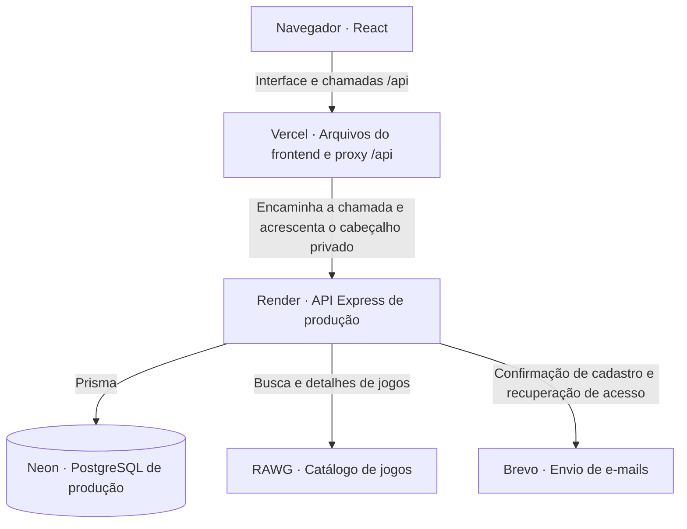
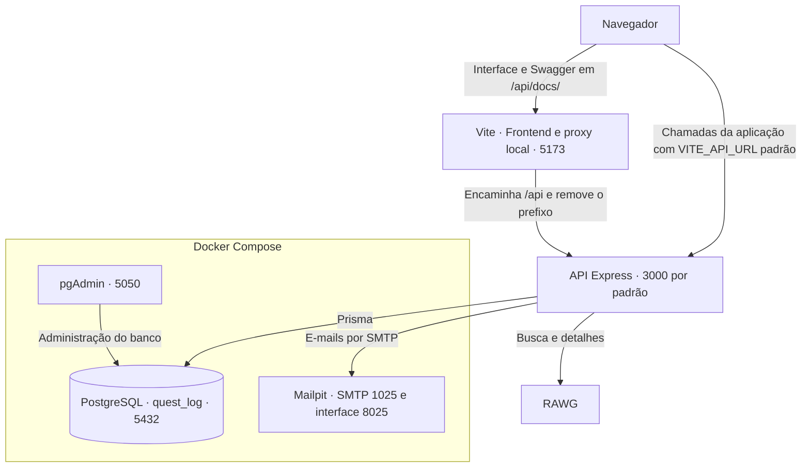
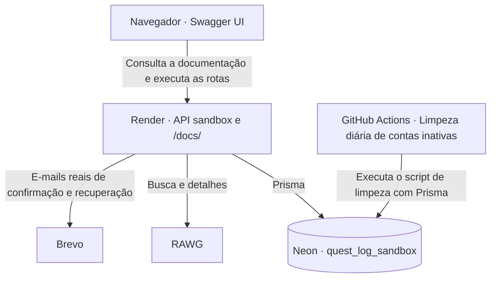
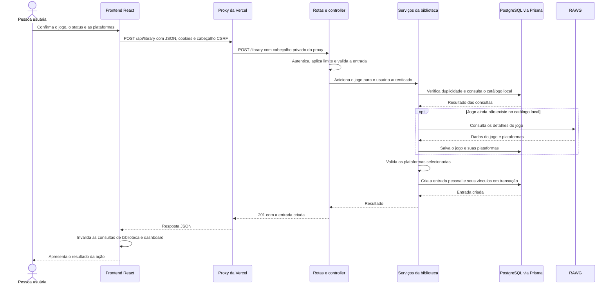

# Arquitetura do QuestLog

[Voltar ao índice dos guias](README.md)

O QuestLog reúne uma aplicação React e uma API Express no mesmo repositório. O frontend apresenta a biblioteca e coordena as interações; o backend aplica as regras de negócio, acessa o PostgreSQL com Prisma e se comunica com RAWG e serviços de e-mail.

Este guia apresenta como essas partes se conectam. As instruções de instalação estão no [README principal](../README.md#como-executar-localmente), e os contratos dos endpoints estão no [Swagger](../README.md#documentação-da-api).

## Partes do sistema

| Parte      | Responsabilidade                                                               | Referência no projeto                                                                      |
| ---------- | ------------------------------------------------------------------------------ | ------------------------------------------------------------------------------------------ |
| Frontend   | Interface React, navegação, formulários, estado da sessão e consultas à API.   | [Inicialização](../frontend/src/main.tsx) e [rotas](../frontend/src/routes/AppRoutes.tsx). |
| Backend    | API REST para autenticação, jogos, biblioteca, dashboard e saúde do servidor.  | [Aplicação Express](../backend/src/app.ts) e [rotas](../backend/src/routes/index.ts).      |
| PostgreSQL | Dados das contas, sessões, catálogo local de jogos e bibliotecas pessoais.     | [Modelo Prisma](../backend/prisma/schema.prisma).                                          |
| RAWG       | Busca e detalhes dos jogos disponíveis no catálogo externo.                    | [Integração RAWG](../backend/src/integrations/rawg.ts).                                    |
| E-mail     | Códigos de confirmação de cadastro e recuperação de acesso, via SMTP ou Brevo. | [Seleção do provedor](../backend/src/integrations/mail.ts).                                |

### Organização do frontend

As [páginas](../frontend/src/pages) combinam [componentes](../frontend/src/components) para montar as telas. O React Router define a navegação e os acessos às áreas públicas e protegidas. Os formulários usam React Hook Form e Zod para tratar preenchimento e validação.

Os [hooks](../frontend/src/hooks) de consulta e mutação usam TanStack Query para buscar dados, manter o cache e atualizar consultas após alterações. Os [services](../frontend/src/services) descrevem as chamadas de cada recurso. O [cliente HTTP compartilhado](../frontend/src/services/api.ts) envia cookies, acrescenta os cabeçalhos necessários e trata respostas e falhas de rede.

Os [contextos](../frontend/src/contexts) mantêm estados compartilhados, como o usuário autenticado e as etapas de cadastro e recuperação de acesso. O estado da sessão fica separado do cache de consultas à biblioteca e ao dashboard.

### Organização do backend

| Camada              | Responsabilidade                                                                             | Exemplo da biblioteca                                                      |
| ------------------- | -------------------------------------------------------------------------------------------- | -------------------------------------------------------------------------- |
| Rotas e middlewares | Associar o endpoint à operação, verificar autenticação, aplicar limites e validar a entrada. | [library.router.ts](../backend/src/routes/library.router.ts)               |
| Schemas             | Definir os formatos e as restrições dos dados recebidos com Zod.                             | [library.schema.ts](../backend/src/schemas/library.schema.ts)              |
| Controllers         | Extrair os dados da requisição, chamar o serviço e produzir a resposta HTTP.                 | [library.controller.ts](../backend/src/controllers/library.controller.ts)  |
| Services            | Executar as regras de negócio e coordenar consultas, integrações e transações.               | [library.service.ts](../backend/src/services/library.service.ts)           |
| Repositories        | Consultar e alterar os dados por meio do Prisma.                                             | [library.repository.ts](../backend/src/repositories/library.repository.ts) |
| Integrations        | Comunicar-se com serviços externos e adaptar suas respostas ao projeto.                      | [rawg.ts](../backend/src/integrations/rawg.ts)                             |

Os middlewares gerais são configurados em `app.ts`, antes das rotas. Eles incluem identificação das requisições, cabeçalhos de segurança, proteção de origem, CORS, proteção CSRF e leitura de JSON e cookies. Depois das rotas, o tratamento de caminhos inexistentes e o [tratamento centralizado de erros](../backend/src/middlewares/errorHandler.middleware.ts) produzem as respostas de falha.

## Produção

A interface é hospedada na Vercel; a API executa no Render; o PostgreSQL fica no Neon.

No build de produção, o cliente HTTP usa `/api`. Por exemplo, o navegador chama `/api/library` no domínio da aplicação; a [configuração da Vercel](../frontend/vercel.json) encaminha essa chamada para `/library` no Render. O prefixo `/api` pertence ao proxy; as rotas do Express são registradas sem ele.

A Vercel acrescenta `X-QuestLog-Origin-Secret` às chamadas encaminhadas. A API compara esse cabeçalho com `ORIGIN_SECRET`; o valor fica nas configurações da infraestrutura, fora do código entregue ao navegador. Essa verificação controla a entrada pelo proxy, enquanto os cookies identificam o usuário nas rotas protegidas. O healthcheck `GET /healthz` tem uma exceção para permitir a consulta direta pelo Render.

Os diagramas representam os fluxos da aplicação e da API. Recursos visuais, como imagens dos jogos e fontes, também podem ser carregados pelo navegador de serviços externos.

## Desenvolvimento local

O backend e os servidores de desenvolvimento do frontend e do Storybook executam como processos Node.js na máquina. A interface React executa no navegador. O [Docker Compose](../compose.yaml) fornece PostgreSQL, pgAdmin e Mailpit.

Com o [exemplo de ambiente do frontend](../frontend/.env.example), a aplicação chama `http://localhost:3000` diretamente. Também existe um [proxy no Vite](../frontend/vite.config.ts) para `/api`, usado pelo Swagger local em `http://localhost:5173/api/docs/`. Se `VITE_API_URL` for `/api`, as chamadas da aplicação também passam por esse proxy.

O backend permite a origem local configurada em `FRONTEND_URL` e aceita credenciais nas chamadas entre origens. O Mailpit recebe os e-mails de desenvolvimento, permitindo consultar os códigos sem enviá-los a uma caixa de entrada real.

O Compose inicia a infraestrutura. Os comandos da raiz coordenam o início dos servidores e a preparação do banco; consulte o [guia de execução local](../README.md#como-executar-localmente) para os comandos e a configuração dos cookies usados pelo Swagger.

## Sandbox público

O [Swagger público](https://questlog-sandbox.onrender.com/docs/) executa as operações contra uma instalação própria da API no Render, conectada a um banco Neon separado da produção. O sandbox usa o mesmo código do backend, com configuração e credenciais próprias.

A documentação e a API usam a mesma origem, sem o proxy privado da Vercel. Por isso, `FRONTEND_URL` corresponde ao endereço do próprio serviço sandbox, `ORIGIN_SECRET` fica sem configuração e os caminhos da API não recebem `/api`.

As operações são reais: criar uma conta, adicionar um jogo ou excluir a conta altera o banco do sandbox. As contas da aplicação principal não fazem parte desse ambiente; para experimentar as rotas protegidas, o visitante se cadastra e faz login no próprio sandbox.

A atividade das contas é registrada em `lastActiveAt`. O [workflow de limpeza](../.github/workflows/sandbox-cleanup.yml) executa diariamente um script que remove contas criadas há mais de 30 dias e sem atividade nesse período. O script verifica o ambiente e o nome do banco conectado antes da exclusão. A tarefa executa no GitHub Actions e acessa o banco, sem depender de uma chamada HTTP à API do Render.

### Identificação dos ambientes

| Instalação      | `NODE_ENV`    | `APP_ENV`     | Destino dos dados                                                      |
| --------------- | ------------- | ------------- | ---------------------------------------------------------------------- |
| Desenvolvimento | `development` | `development` | PostgreSQL local, banco `quest_log`.                                   |
| Testes          | `test`        | `test`        | Bancos isolados `quest_log_test` ou `quest_log_e2e`, conforme a suíte. |
| Produção        | `production`  | `production`  | PostgreSQL de produção no Neon.                                        |
| Sandbox         | `production`  | `sandbox`     | PostgreSQL próprio no Neon, banco `quest_log_sandbox`.                 |

`NODE_ENV` define o modo de execução do Node e das bibliotecas. `APP_ENV` identifica a instalação do QuestLog; quando ausente, acompanha `NODE_ENV`. A [validação dos ambientes](../backend/src/lib/appEnvironment.ts) exige combinações coerentes. A separação efetiva dos dados depende das conexões e credenciais configuradas para cada instalação.

## Exemplo de fluxo: adicionar um jogo à biblioteca

O diagrama abaixo acompanha uma adição bem-sucedida na aplicação de produção. Autenticação, limites de requisições e validação acontecem antes da execução do serviço.

O [hook de adição](../frontend/src/hooks/library.hook.ts) chama o service HTTP e invalida as consultas relacionadas após o sucesso. No backend, o [controller](../backend/src/controllers/library.controller.ts) obtém o usuário da sessão, e o [serviço da biblioteca](../backend/src/services/library.service.ts) coordena a operação.

O catálogo local guarda os dados compartilhados do jogo. A entrada da biblioteca liga esse jogo a uma pessoa e mantém seu progresso, nota, tempo e datas. Um mesmo jogo pode aparecer nas bibliotecas de diferentes usuários com registros pessoais distintos.

O [guia do banco de dados](../backend/docs/database.md) detalha esses modelos, seus relacionamentos, regras de persistência e migrations.

O [serviço de obtenção do jogo](../backend/src/services/library-game.service.ts) reutiliza o catálogo local quando possível. A busca e a consulta de detalhes pelas rotas `/games`, por sua vez, acessam a RAWG. O [dashboard](../backend/src/services/dashboard.service.ts) calcula as estatísticas a partir dos registros da biblioteca no PostgreSQL.

## Sessão, proteções e falhas

O backend emite os cookies `accessToken` e `refreshToken` com `HttpOnly`; o navegador os envia conforme a origem e os caminhos configurados. O frontend consulta o usuário da sessão e, ao receber `401` em uma chamada elegível, tenta renovar a sessão e repetir a requisição uma vez. Essa coordenação está no cliente HTTP da aplicação; o Swagger não executa a mesma renovação automática.

O [guia de autenticação](../backend/docs/authentication.md) detalha cadastro, login, renovação, cookies, recuperação de acesso e encerramento das sessões.

As verificações se complementam:

- **Autenticação:** verifica o token de acesso, a existência do usuário e a versão da sessão nas rotas protegidas.
- **Proteção do proxy:** confere o cabeçalho privado no backend de produção.
- **CORS:** define a origem do frontend autorizada a ler respostas pelo navegador com credenciais.
- **Proteção CSRF:** nas operações de escrita, exige a origem configurada, o cabeçalho `X-QuestLog-Request: true` e, quando há corpo, o envio em JSON.
- **Validação e limites:** verificam os dados recebidos e limitam chamadas conforme a operação.

Erros de negócio e de integração são convertidos em respostas HTTP. A integração RAWG valida as respostas externas e trata falhas de rede e timeout. Os logs da API incluem a identificação da requisição, devolvida no cabeçalho `X-Request-Id`, para ajudar a investigar falhas.

O endpoint `GET /healthz` responde `{"status":"ok"}` quando o servidor consegue atender à consulta. Ele não consulta o banco nem verifica RAWG ou o provedor de e-mail.

## Documentação e tarefas operacionais

O OpenAPI é montado a partir dos registros em [backend/src/openapi](../backend/src/openapi) e de schemas reutilizados do projeto. O Swagger UI é servido em `/docs` no desenvolvimento e no sandbox; a instalação principal de produção não expõe essa interface.

O Storybook usa os componentes do frontend com exemplos, dados fictícios e operações simuladas. Ele pode executar sem API ou banco e não altera os dados do sandbox nem da aplicação principal. Os arquivos de configuração ficam em [frontend/.storybook](../frontend/.storybook), e os exemplos ficam em [frontend/stories](../frontend/stories). A publicação do catálogo ainda está pendente; os comandos locais estão no [README](../README.md#catálogo-de-componentes).

A [CI](../.github/workflows/ci.yml) verifica formatação, scripts de desenvolvimento, backend, frontend, build do Storybook e testes E2E. Em pushes na `main`, depois das verificações, jobs separados acionam os deploys de produção e sandbox no Render. A hospedagem do frontend usa a integração da Vercel.

Além da limpeza diária de contas do sandbox, o próprio [processo do servidor](../backend/src/server.ts) inicia tarefas periódicas para remover cadastros pendentes e recuperações de senha expirados. Essas tarefas pertencem à API em execução; a limpeza diária do sandbox pertence ao workflow separado.
