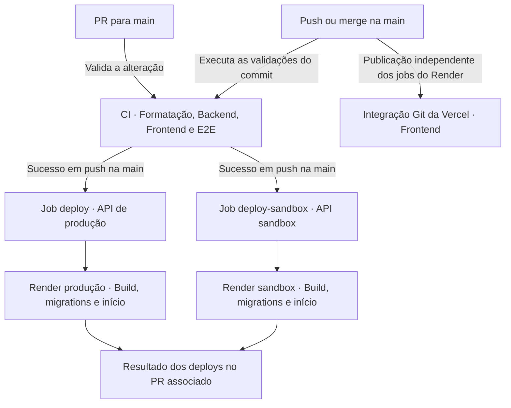

# Deploy e operação dos ambientes

[Voltar ao índice dos guias](README.md) · [Arquitetura geral](architecture.md) · [Testes e CI](testing.md)

O frontend do QuestLog é hospedado na Vercel, as APIs de produção e sandbox executam em serviços separados no Render, e os bancos PostgreSQL ficam no Neon. Os deploys do backend são acionados pelo GitHub Actions após as validações da CI.

Este guia reúne a configuração de referência e o fluxo de publicação. Os workflows e o proxy estão versionados; conexões, credenciais, comandos dos serviços e opções dos painéis precisam ser mantidos nas respectivas plataformas. O repositório não contém um Blueprint do Render que provisione esses serviços automaticamente.

## Destinos e responsabilidades

| Parte                 | Hospedagem                  | Endereço ou finalidade                                                                |
| --------------------- | --------------------------- | ------------------------------------------------------------------------------------- |
| Aplicação principal   | Vercel.                     | [QuestLog](https://quest-log-omega-jade.vercel.app/).                                 |
| API de produção       | Render.                     | `https://questlog-api-a95s.onrender.com`, destino do proxy em `frontend/vercel.json`. |
| Banco de produção     | Neon.                       | Contas, sessões e bibliotecas da aplicação principal.                                 |
| API e Swagger sandbox | Outro serviço no Render.    | [Swagger público](https://questlog-sandbox.onrender.com/docs/).                       |
| Banco do sandbox      | Neon, separado da produção. | Banco `quest_log_sandbox`, usado nas demonstrações públicas.                          |
| Storybook público     | Outro projeto na Vercel.    | [Catálogo de componentes](https://questlog-storybook.vercel.app/).                    |

O sandbox usa o mesmo código da API, com banco e credenciais próprios. Uma conta criada no Swagger público pertence a esse ambiente. O Storybook usa simulações e não depende de uma dessas APIs para seus exemplos.

## O que está versionado

| Arquivo                                                         | Responsabilidade                                                                                 |
| --------------------------------------------------------------- | ------------------------------------------------------------------------------------------------ |
| [ci.yml](../.github/workflows/ci.yml)                           | Validações, acionamento dos dois deploys no Render e comentário com o resultado no PR associado. |
| [sandbox-cleanup.yml](../.github/workflows/sandbox-cleanup.yml) | Exclusão agendada de contas inativas no banco sandbox.                                           |
| [frontend/vercel.json](../frontend/vercel.json)                 | Proxy `/api`, cabeçalho privado e fallback da aplicação React.                                   |
| [backend/package.json](../backend/package.json)                 | Build TypeScript, início da API compilada e comando de limpeza do sandbox.                       |
| [frontend/package.json](../frontend/package.json)               | Builds da aplicação e do catálogo de componentes.                                                |
| [prisma.config.ts](../backend/prisma.config.ts)                 | Escolha da conexão dos comandos do Prisma e diretório das migrations.                            |
| [backend/.env.example](../backend/.env.example)                 | Referência das variáveis aceitas pela API.                                                       |

## Fluxo de publicação

Em um PR, a CI executa as validações; os jobs de deploy do backend exigem um evento `push` na `main`. Ambos dependem de `formatting`, `backend`, `frontend` e `e2e`. O SHA do commit é enviado ao Render, e cada job aguarda o resultado do seu serviço.

Os serviços têm grupos de concorrência separados, `render-production` e `render-sandbox`, sem cancelamento da execução em andamento nesses grupos. A limpeza de contas tem outro workflow e não é uma dependência desses deploys.

O job `deploy-comment` procura um PR já mergeado associado ao commit e cria ou atualiza o comentário com os dois resultados e o link da execução. Um push sem PR associado mantém os resultados no GitHub Actions. O registro de GitHub Deployment e o comentário na conversa do PR são saídas diferentes desse fluxo.

A integração Git da Vercel publica o frontend separadamente. O workflow atual não controla esse deploy nem estabelece uma publicação atômica entre frontend, APIs e bancos.

## Bancos no Neon

Mantenha conexões separadas para produção e sandbox. Para cada instalação, obtenha a conexão com pooling para `DATABASE_URL` e a conexão direta para `DIRECT_URL`, ambas apontando para o mesmo banco daquele ambiente. O painel **Connect** do Neon disponibiliza os dois tipos; a conexão com pooling contém `-pooler` no host. Veja a [documentação de Prisma no Neon](https://neon.com/docs/guides/prisma).

No QuestLog, a API usa `DATABASE_URL` pelo adapter `@prisma/adapter-pg`. Os comandos do Prisma priorizam `DIRECT_URL` e usam `DATABASE_URL` como alternativa quando a primeira não está preenchida. Essa escolha está no código do projeto, independentemente dos nomes usados em exemplos de outros adapters.

O exemplo de ambiente do backend orienta `sslmode=verify-full` para a conexão da aplicação no Render/Neon, preservando os demais parâmetros da URL. As URLs completas contêm credenciais e ficam nos painéis ou nos secrets, sem serem adicionadas ao Git.

O nome `quest_log_sandbox` é obrigatório para a rotina de limpeza: ela confere tanto a URL quanto o nome do banco conectado. As migrations precisam ser aplicadas separadamente no banco de produção e no banco sandbox. A [documentação do banco](../backend/docs/database.md) detalha o modelo e seus relacionamentos.

## APIs no Render

### Configuração dos serviços

Os dois serviços usam o mesmo repositório e a branch `main`, com configurações de ambiente próprias. Configure no painel de cada serviço:

| Campo             | Referência para o QuestLog                                      |
| ----------------- | --------------------------------------------------------------- |
| Tipo e runtime    | Web Service com Node.js.                                        |
| Root Directory    | `backend`.                                                      |
| Node.js           | `NODE_VERSION=24`, acompanhando a versão principal usada na CI. |
| Build Command     | `npm ci --include=dev && npx prisma generate && npm run build`  |
| Start Command     | `npx prisma migrate deploy && npm start`                        |
| Health Check Path | `/healthz`.                                                     |
| Auto-Deploy       | `Off`, pois o GitHub Actions aciona os deploys.                 |

O Render permite definir a versão pelo ambiente do serviço; veja [configuração de Node.js](https://render.com/docs/node-version). A [documentação de deploys](https://render.com/docs/deploys) explica as opções de Auto-Deploy e o acionamento por commit específico. Neste fluxo, mantenha `Off` nos dois serviços para que a publicação seja coordenada pelos jobs do GitHub.

O build instala também as dependências de desenvolvimento necessárias ao TypeScript e ao Prisma, gera o cliente e compila a API. O script de build copia `src/assets` para `dist/assets`, preservando os arquivos usados pelos e-mails.

O Start Command aplica as migrations antes de iniciar `dist/server.js`. Se a migration falhar, o `&&` impede o início dessa nova execução da API. Os comandos de build e início são configurações de painel; o workflow aciona o serviço, mas não define esses comandos para ele.

O [servidor](../backend/src/server.ts) usa `PORT` fornecida pelo ambiente antes de `PORT_LOCAL`. A orientação do Render é atender na porta indicada por `PORT`; consulte [Web Services](https://render.com/docs/web-services#port-binding).

### Variáveis de ambiente

| Variável                  | Produção                                                                       | Sandbox                                                                          |
| ------------------------- | ------------------------------------------------------------------------------ | -------------------------------------------------------------------------------- |
| `NODE_VERSION`            | `24`.                                                                          | `24`.                                                                            |
| `NODE_ENV`                | `production`.                                                                  | `production`.                                                                    |
| `APP_ENV`                 | `production`.                                                                  | `sandbox`.                                                                       |
| `DATABASE_URL`            | Conexão com pooling do banco de produção.                                      | Conexão com pooling de `quest_log_sandbox`.                                      |
| `DIRECT_URL`              | Conexão direta do mesmo banco de produção.                                     | Conexão direta do mesmo banco sandbox.                                           |
| `JWT_SECRET`              | Segredo da autenticação de produção.                                           | Outro segredo, exclusivo do sandbox.                                             |
| `RAWG_API_KEY`            | Chave válida da integração.                                                    | Chave válida da integração.                                                      |
| `FRONTEND_URL`            | `https://quest-log-omega-jade.vercel.app`, origem da aplicação principal.      | `https://questlog-sandbox.onrender.com`, origem do próprio serviço, sem `/docs`. |
| `ORIGIN_SECRET`           | Segredo privado, com pelo menos 32 caracteres, igual ao configurado na Vercel. | Sem configuração; o código rejeita um segredo nesse ambiente.                    |
| `AUTH_COOKIE_PATH_PREFIX` | Padrão `/api`, podendo permanecer sem definição.                               | Padrão vazio; deixe sem definição. O código rejeita `/api`.                      |
| `TRUST_PROXY_HOPS`        | Valor conferido para a cadeia de proxies dessa instalação.                     | Valor conferido para a cadeia de proxies dessa instalação.                       |
| `EMAIL_PROVIDER`          | `brevo`.                                                                       | `brevo`.                                                                         |
| `BREVO_API_KEY`           | Chave da conta de envio usada pela produção.                                   | Chave destinada ao sandbox.                                                      |
| `BREVO_SENDER_EMAIL`      | Remetente habilitado na conta de envio.                                        | Remetente habilitado na conta de envio.                                          |
| `BREVO_SENDER_NAME`       | `QuestLog` ou nome de exibição configurado.                                    | Nome de exibição configurado para a demonstração.                                |
| `EMAIL_LOGO_URL`          | Opcional; sem ela, a imagem é buscada a partir de `FRONTEND_URL`.              | Configure a URL HTTPS da imagem pública do frontend.                             |
| `LOG_LEVEL`               | Opcional; padrão `info`.                                                       | Opcional; padrão `info`.                                                         |

No sandbox, a logo pode usar `https://quest-log-omega-jade.vercel.app/favicon/android-chrome-192x192.png`, conforme o exemplo de ambiente. Isso evita procurar a imagem no serviço da API, que não hospeda os favicons do frontend.

`NODE_ENV=production` habilita o comportamento de execução de produção, incluindo cookies `Secure`. `APP_ENV=sandbox` identifica a instalação de demonstração. A [validação dos ambientes](../backend/src/lib/appEnvironment.ts) exige essa combinação para o sandbox.

`FRONTEND_URL` participa da configuração de CORS e da proteção CSRF. Use a origem HTTPS correta, sem caminhos de páginas. Não copie o valor da aplicação principal para o sandbox. Para conferir o endereço de um serviço, use a URL exibida no Render; a plataforma também disponibiliza `RENDER_EXTERNAL_URL`, descrita em [variáveis padrão](https://render.com/docs/environment-variables).

O número de proxies pode variar entre as instalações porque a produção passa também pela Vercel. Mantenha o valor validado de `TRUST_PROXY_HOPS` em cada serviço. Os detalhes de caminhos e cookies estão no [guia de autenticação](../backend/docs/authentication.md#cookies-e-caminhos-por-ambiente).

## Frontend na Vercel

Configure o projeto da aplicação com estes valores de referência:

| Campo                     | Valor                                                      |
| ------------------------- | ---------------------------------------------------------- |
| Root Directory            | `frontend`.                                                |
| Framework                 | Vite.                                                      |
| Node.js                   | Versão principal `24`.                                     |
| Install Command           | `npm ci`.                                                  |
| Build Command             | `npm run build`.                                           |
| Output Directory          | `dist`.                                                    |
| Production Branch         | `main`.                                                    |
| Variável privada do proxy | `ORIGIN_SECRET`, com o mesmo valor do backend de produção. |

As opções de diretório, instalação, build e saída ficam nas configurações do projeto; veja [Configuring a Build](https://vercel.com/docs/builds/configure-a-build).

O [cliente HTTP](../frontend/src/services/api.ts) usa `/api` no build de produção. `VITE_API_URL` configura o desenvolvimento e não troca o destino do proxy no site publicado. A rota do proxy está em `frontend/vercel.json` e encaminha para a API de produção no Render.

Essa configuração acrescenta `X-QuestLog-Origin-Secret` usando `ORIGIN_SECRET` do ambiente da Vercel. A expansão da variável no transform depende da lista `env` já presente no arquivo; veja [variáveis em transforms](https://vercel.com/docs/project-configuration/vercel-json#in-transforms). O valor pertence à infraestrutura e não deve ser colocado em uma variável `VITE_*`.

O mesmo arquivo mantém o acesso aos arquivos estáticos e o fallback para `index.html`, permitindo abrir rotas do React diretamente. Se o endereço da API mudar, atualize o destino do proxy e publique novamente. Alterações nas variáveis da Vercel se aplicam a novos deploys, conforme a [documentação de ambiente](https://vercel.com/docs/environment-variables).

### Previews e sandbox

O workflow não cria APIs ou bancos por PR. Uma preview do frontend depende das configurações da Vercel, e o `vercel.json` atual continua apontando `/api` para a API de produção. A origem de uma preview também não é automaticamente incluída no `FRONTEND_URL` confiável do backend.

Por isso, uma preview do frontend não equivale ao sandbox público da API. O ambiente de demonstração está no serviço `questlog-sandbox`, com suas próprias contas e dados.

## Secrets no GitHub Actions

Cadastre os secrets do repositório usados pelos workflows:

| Secret                      | Uso                                                                   |
| --------------------------- | --------------------------------------------------------------------- |
| `RENDER_API_KEY`            | Autenticar o acionamento e acompanhamento dos deploys no Render.      |
| `RENDER_SERVICE_ID`         | Identificar o serviço da API de produção.                             |
| `RENDER_SANDBOX_SERVICE_ID` | Identificar o outro serviço, da API sandbox.                          |
| `SANDBOX_DATABASE_URL`      | Conexão exclusiva de `quest_log_sandbox`, usada na limpeza de contas. |

Os IDs dos serviços são identificadores como `srv-...`, não nomes nem URLs públicas. Confira o serviço correspondente ao copiar cada ID. O Render distingue o identificador da URL pública; a referência aparece nas [variáveis padrão do serviço](https://render.com/docs/environment-variables).

`GITHUB_TOKEN` é disponibilizado pelo GitHub à execução. Os jobs declaram as permissões necessárias: os deploys podem criar registros de deployment, e o comentário pode escrever no PR. O segredo privado do proxy, as credenciais da Brevo e as conexões normais das APIs ficam nos ambientes das hospedagens; os jobs de deploy não os enviam como parâmetros.

## Migrations e ordem de publicação

O SQL das migrations acompanha o código em `backend/prisma/migrations`. O merge publica os arquivos no repositório; a alteração no banco acontece quando `prisma migrate deploy` é executado com a conexão daquele ambiente.

Com o Start Command indicado neste guia, a sequência de cada serviço é:

1. Instalar dependências, gerar o Prisma Client e compilar.
2. Aplicar as migrations pendentes usando `DIRECT_URL`, ou `DATABASE_URL` quando a conexão direta não estiver preenchida.
3. Iniciar a API compilada, que usa `DATABASE_URL` para as consultas normais.
4. Conferir o healthcheck e o resultado do deploy no Render e no GitHub Actions.

Cada serviço pode ter um resultado diferente. Um deploy de produção concluído não prova que o sandbox recebeu a mesma versão ou aplicou suas migrations. O comentário do PR mostra ambos, e os logs de cada serviço mostram a aplicação das migrations e o início da API.

As validações da CI usam bancos de teste. A limpeza agendada usa o banco sandbox já existente e não aplica migrations; ela fica em um workflow separado, sem bloquear a etapa que precisa atualizar o serviço e seu banco.

Reverter o código não desfaz o SQL já aplicado. Planeje mudanças compatíveis com a versão que ainda pode estar atendendo durante a publicação. Antes de operações que alterem ou removam dados existentes, confira também o procedimento de backup e restauração do banco, validando a recuperação em um destino separado. O [guia do banco](../backend/docs/database.md#evolução-com-migrations) descreve a criação e aplicação das migrations.

## Limpeza de contas do sandbox

O workflow [sandbox-cleanup.yml](../.github/workflows/sandbox-cleanup.yml) aceita acionamento manual e agenda uma execução semanal com `17 6 * * 0`, aos **domingos, às 06:17 UTC (03:17 em Brasília)**. O job exige a referência `main` e executa `npm run sandbox:cleanup -- --execute` dentro do backend compilado.

Ele instala dependências, gera o cliente e compila com uma conexão fictícia de configuração. Somente na etapa de limpeza recebe `SANDBOX_DATABASE_URL` como `DATABASE_URL`. Essa etapa verifica o secret, a identificação do ambiente e o nome real do banco antes da exclusão.

São elegíveis contas criadas há mais de 30 dias e com `lastActiveAt` anterior ao limite ou ausente. Como a execução é semanal, uma conta elegível pode aguardar quase sete dias pela próxima limpeza, considerando o calendário normal de execuções. A exclusão reavalia essas condições no banco e remove os dados pessoais relacionados por cascata. Jogos e plataformas compartilhados permanecem no catálogo.

O [script](../backend/src/scripts/cleanupSandbox.ts) imprime `mode`, `database`, `inactivityDays`, `cutoff`, `candidates` e `deleted`. Também escreve um resumo na execução do GitHub Actions com modo, prazo, corte e quantidades. A configuração atual usa o modo de exclusão; acionar o workflow manualmente também usa `--execute`.

O comando do backend aceita `--dry-run` para somente conferir e `--execute` para excluir, exigindo em ambos o ambiente sandbox. O workflow atual não oferece um seletor de modo no acionamento manual. A limpeza acessa o banco diretamente e não precisa manter uma requisição HTTP aberta na API do Render.

## Publicação do Storybook

O [catálogo público](https://questlog-storybook.vercel.app/) é hospedado em um projeto próprio na Vercel, chamado `questlog-storybook`, conectado ao mesmo repositório. O catálogo gera arquivos estáticos com `npm run build-storybook` dentro de `frontend/`, com saída em `storybook-static/`. A CI também confere esse build no job do frontend.

Use esta configuração de referência no projeto do catálogo:

| Campo              | Valor                                        |
| ------------------ | -------------------------------------------- |
| Root Directory     | Raiz do repositório, `./`.                   |
| Application Preset | `Other`.                                     |
| Node.js            | Versão principal `24`.                       |
| Install Command    | `npm ci --prefix frontend`.                  |
| Build Command      | `npm run build-storybook --prefix frontend`. |
| Output Directory   | `frontend/storybook-static`.                 |
| Production Branch  | `main`.                                      |

O Root Directory fica na raiz, e os comandos usam `--prefix frontend` para executar na aplicação correta. Assim, o catálogo não usa `frontend/vercel.json`, que pertence à aplicação principal e contém proxy privado e fallback para o React. Essas opções ficam no painel do projeto do catálogo; não há um arquivo de configuração da Vercel na raiz do repositório.

Os exemplos usam dados fictícios e operações simuladas, sem exigir variáveis de ambiente da API ou o segredo privado do proxy. A integração Git da Vercel publica o catálogo; a CI verifica seu build, mas não contém um job que acione esse deploy. O link público e o badge ficam no [README](../README.md#catálogo-de-componentes).

## Conferência após publicar

1. No GitHub Actions, confira separadamente os resultados dos dois deploys e o SHA publicado.
2. No Render, confira a aplicação das migrations, a mensagem de início e o healthcheck de cada serviço. `GET /healthz` responde `{"status":"ok"}` quando o servidor atende; não verifica banco, RAWG nem Brevo.
3. Pela aplicação principal, confira login, consulta da biblioteca e renovação da sessão. Use uma conta de teste ao validar gravações.
4. Pelo Swagger público, confira cadastro, e-mail, login, renovação e uma operação da biblioteca no sandbox. Verifique a logo da mensagem e a separação das contas.
5. Depois da limpeza agendada ou manual, confira o resumo do workflow e as quantidades de contas elegíveis e excluídas.

Acessar diretamente a raiz da API de produção no Render pode retornar `{"message":"Acesso à API não permitido."}` por causa da proteção do proxy. Isso não demonstra que o serviço está fora do ar. A aplicação usa `/api` pela Vercel; o healthcheck tem uma exceção para consulta direta. O Swagger é servido no desenvolvimento e no sandbox, não na instalação principal de produção.

## Onde investigar uma falha

| Sintoma                                    | Onde conferir                                                                                         |
| ------------------------------------------ | ----------------------------------------------------------------------------------------------------- |
| Acionamento do deploy falha antes do build | Secrets de API e IDs de serviço no GitHub Actions.                                                    |
| Build do Render falha                      | Root Directory, Node.js, instalação das dependências e logs do comando de build.                      |
| Migration falha ou há coluna ausente       | Conexão do ambiente, `DIRECT_URL`, Start Command, SQL pendente e histórico do deploy daquele serviço. |
| API não inicia                             | Variáveis obrigatórias, combinação `NODE_ENV`/`APP_ENV`, porta e logs de início.                      |
| Aplicação recebe bloqueio de origem        | Destino do proxy, igualdade de `ORIGIN_SECRET` e origem confiável em `FRONTEND_URL`.                  |
| Sessão não renova                          | Prefixo e caminho dos cookies, HTTPS e rota de refresh usada pelo navegador.                          |
| E-mail falha ou aparece sem logo           | Configuração Brevo, remetente e URL HTTPS de `EMAIL_LOGO_URL` ou do frontend.                         |
| Limpeza do sandbox falha                   | Secret de conexão, migrations do sandbox, ambiente e nome do banco exigido.                           |
| Somente um ambiente recebeu a versão nova  | Resultado e logs do job e do serviço correspondentes; os deploys são independentes.                   |

O [guia de logs](../backend/docs/logging.md) apresenta os eventos e os campos usados na investigação. As proteções e os fluxos da sessão estão no [guia de autenticação](../backend/docs/authentication.md). As verificações anteriores à publicação estão no [guia de testes](testing.md).
