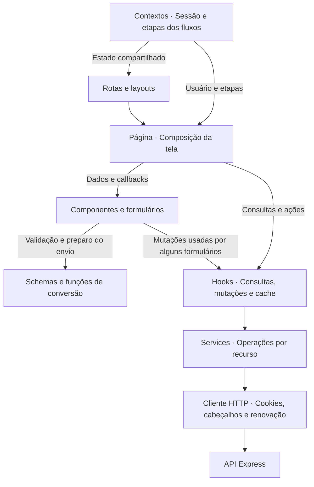
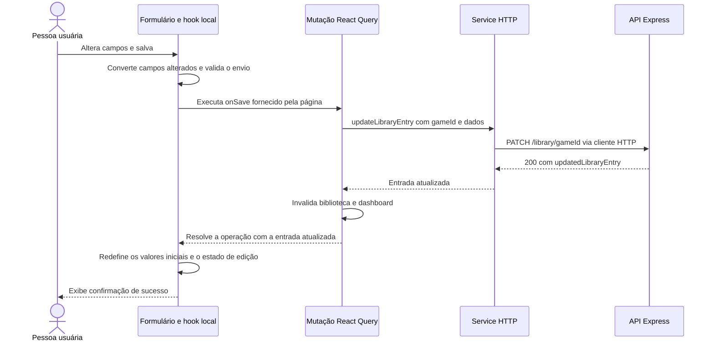

# Arquitetura do frontend

[Voltar ao índice dos guias](../../docs/README.md) · [Arquitetura geral](../../docs/architecture.md)

O frontend do QuestLog é uma aplicação React com TypeScript, construída com Vite e executada no navegador. As páginas combinam componentes, os hooks de dados usam TanStack Query e os serviços centralizam a comunicação com a API Express.

Este guia explica a organização do código e o caminho dos dados na interface. Os comandos de instalação, desenvolvimento e testes estão no [README principal](../../README.md); os detalhes de cookies e renovação estão no [guia de autenticação](../../backend/docs/authentication.md).

## Organização dos arquivos

Os caminhos abaixo são relativos a `frontend/`:

| Local                      | Responsabilidade                                                                         | Exemplo                                                                                                   |
| -------------------------- | ---------------------------------------------------------------------------------------- | --------------------------------------------------------------------------------------------------------- |
| `src/pages/`               | Compor a tela de uma rota, ler seus parâmetros e conectar dados e ações aos componentes. | [LibraryGameDetails.tsx](../src/pages/LibraryGameDetails.tsx)                                             |
| `src/routes/`              | Definir as rotas, seus layouts e as condições de navegação conforme a sessão.            | [AppRoutes.tsx](../src/routes/AppRoutes.tsx)                                                              |
| `src/components/`          | Componentes de UI e componentes agrupados por área da aplicação.                         | [Formulário da biblioteca](../src/components/library/details/LibraryGameDetailsForm.tsx)                  |
| `src/hooks/`               | Consultas, mutações e comportamentos reutilizados por páginas e componentes.             | [library.hook.ts](../src/hooks/library.hook.ts)                                                           |
| `src/services/`            | Requisições por recurso e cliente HTTP compartilhado.                                    | [library.service.ts](../src/services/library.service.ts) e [api.ts](../src/services/api.ts)               |
| `src/contexts/`            | Estado da sessão e coordenação das etapas de cadastro e recuperação de acesso.           | [AuthProvider.tsx](../src/contexts/AuthProvider.tsx)                                                      |
| `src/schema/`              | Schemas Zod dos dados de entrada e formulários.                                          | [library.schema.ts](../src/schema/library.schema.ts)                                                      |
| `src/types/`               | Tipos dos dados e contratos usados pelo frontend.                                        | [library.types.ts](../src/types/library.types.ts)                                                         |
| `src/config/`              | Valores e mapeamentos compartilhados da interface.                                       | [Rótulos e cores dos status](../src/config/gameStatus.config.ts)                                          |
| `src/lib/`                 | Configuração de bibliotecas e suporte a fluxos compartilhados.                           | [queryClient.ts](../src/lib/queryClient.ts) e [registrationSession.ts](../src/lib/registrationSession.ts) |
| `src/utils/`               | Funções de formatação, conversão e tratamento de valores.                                | [formatPlayTime.ts](../src/utils/formatPlayTime.ts)                                                       |
| `src/index.css`            | Tema, fontes e estilos globais.                                                          | [index.css](../src/index.css)                                                                             |
| `public/`                  | Arquivos estáticos da aplicação, como favicons e imagens de apoio.                       | [Arquivos públicos](../public)                                                                            |
| `stories/` e `.storybook/` | Exemplos do catálogo e sua configuração.                                                 | [Stories](../stories) e [configuração](../.storybook)                                                     |
| `tests/`                   | Testes unitários e de integração, helpers, fixtures e simulações.                        | [Testes do frontend](../tests)                                                                            |

Hooks e funções usados somente por um grupo também ficam próximos dos componentes, como [useLibraryGameDetailsForm.ts](../src/components/library/details/useLibraryGameDetailsForm.ts). A pasta `src/hooks/` reúne os hooks compartilhados de dados e comportamentos gerais.

## Inicialização e navegação

[main.tsx](../src/main.tsx) importa os estilos globais e monta a aplicação com esta composição:

```text
StrictMode
└── BrowserRouter
    └── QueryClientProvider
        └── AuthProvider
            └── App
                └── AppRoutes
```

O `BrowserRouter` fornece a navegação; o `QueryClientProvider` disponibiliza a mesma instância de cache às consultas; o `AuthProvider` consulta a sessão e compartilha o usuário. [App.tsx](../src/App.tsx) renderiza as rotas e aplica o comportamento global de impedir o arraste de elementos.

### Rotas e layouts

| Caminho                                                                  | Tela ou comportamento                                | Organização                             |
| ------------------------------------------------------------------------ | ---------------------------------------------------- | --------------------------------------- |
| `/login`                                                                 | Login.                                               | `PublicRoute`.                          |
| `/register` e `/register/verify`                                         | Cadastro e confirmação do e-mail.                    | `PublicRoute` e `RegistrationProvider`. |
| `/forgot-password`, `/forgot-password/verify` e `/forgot-password/reset` | Solicitação, confirmação do código e nova senha.     | `PasswordRecoveryProvider`.             |
| `/`                                                                      | Redireciona para `/dashboard`.                       | `ProtectedRoute` e `AppLayout`.         |
| `/dashboard`                                                             | Visão geral da biblioteca.                           | `ProtectedRoute` e `AppLayout`.         |
| `/games/search`                                                          | Busca no catálogo externo.                           | `ProtectedRoute` e `AppLayout`.         |
| `/games/:externalId`                                                     | Detalhes de um jogo pelo ID da RAWG.                 | `ProtectedRoute` e `AppLayout`.         |
| `/library`                                                               | Biblioteca pessoal e filtros.                        | `ProtectedRoute` e `AppLayout`.         |
| `/library/:gameId`                                                       | Edição de um jogo pelo ID interno do catálogo local. | `ProtectedRoute` e `AppLayout`.         |
| `/profile`                                                               | Dados e ações da conta.                              | `ProtectedRoute` e `AppLayout`.         |
| `*`                                                                      | Página de endereço não encontrado.                   | Fora dos agrupamentos anteriores.       |

[ProtectedRoute](../src/routes/ProtectedRoute.tsx) apresenta carregamento durante a consulta de sessão, oferece nova tentativa quando ela falha e encaminha ao login quando não há usuário autenticado. [PublicRoute](../src/routes/PublicRoute.tsx) usa os mesmos estados e encaminha ao dashboard quem já está autenticado.

As rotas de recuperação não passam por `PublicRoute`; também podem ser acessadas com uma sessão autenticada. As verificações dessas rotas organizam a navegação no navegador. A API continua responsável por autenticar cada requisição protegida.

[AppLayout](../src/components/layout/AppLayout.tsx) reúne cabeçalho, área principal com `Outlet`, atribuição à RAWG e navegação mobile. As páginas de autenticação usam seus próprios componentes de layout. O hook [useDocumentTitle](../src/hooks/useDocumentTitle.ts) atualiza o título da aba conforme a página e os dados carregados.

## Responsabilidades e caminho dos dados



As páginas conectam as partes, mas alguns componentes também usam hooks de dados diretamente. Por exemplo, [AddGameToLibraryModal](../src/components/game/add-game-modal/AddGameToLibraryModal.tsx) chama `useAddGameToLibrary`. Já o formulário de edição recebe `onSave` da página e concentra seu próprio preenchimento e validação. O diagrama mostra essas duas formas presentes no código.

Os services descrevem método, caminho e corpo da requisição e extraem os dados necessários da resposta. Os hooks acrescentam cache e ciclo de vida da consulta ou mutação. Os componentes apresentam os resultados e permitem as interações.

## Onde cada estado fica

| Tipo de estado                    | Onde fica                                       | Exemplo                                                              |
| --------------------------------- | ----------------------------------------------- | -------------------------------------------------------------------- |
| Dados consultados na API          | TanStack Query.                                 | Biblioteca, detalhes de jogos e dashboard.                           |
| Sessão do usuário                 | `AuthProvider`.                                 | Usuário atual e estados de consulta da sessão.                       |
| Etapas de cadastro e recuperação  | Providers próprios desses fluxos.               | Cadastro pendente e autorização temporária de redefinição.           |
| Busca e filtros navegáveis        | Parâmetros da URL, lidos por `useSearchParams`. | Termo e página da busca; título e status da biblioteca.              |
| Campos e validação de formulários | React Hook Form e lógica local do formulário.   | Nota, tempo e datas na edição de um jogo.                            |
| Interação visual temporária       | Estado local de páginas e componentes.          | Modal de exclusão aberto, descrição expandida e mensagem de sucesso. |

O [AuthProvider](../src/contexts/AuthProvider.tsx) mantém `loading`, `authenticated`, `unauthenticated` e `error`, além dos dados públicos do usuário. Ao encerrar a sessão ou receber o evento de expiração, ele limpa o usuário e o cache das consultas. Os tokens de acesso e renovação ficam nos cookies `HttpOnly`, enviados pelo navegador.

Os [providers de cadastro](../src/contexts/RegistrationProvider.tsx) e [recuperação](../src/contexts/PasswordRecoveryProvider.tsx) existem somente em seus grupos de rotas. Eles usam `sessionStorage` para dados limitados de continuidade, como identificador do cadastro, e-mail e prazo de reenvio. Senhas e a autorização `resetToken` permanecem em memória. Os detalhes desse ciclo estão no [guia de autenticação](../../backend/docs/authentication.md).

### Busca e filtros na URL

[SearchGames](../src/pages/SearchGames.tsx) separa o texto sendo digitado do termo já enviado. O envio atualiza `query` na URL e volta à primeira página; a paginação acrescenta `page`. O hook só consulta quando há um termo não vazio, e cada combinação de termo e página tem sua chave de cache.

[Library](../src/pages/Library.tsx) usa `search` e `status` na URL. A busca espera 500 ms antes de aplicar o texto e substitui a entrada atual do histórico nesse ajuste. A página consulta o resultado filtrado e a biblioteca sem filtros: a segunda consulta fornece os contadores e ajuda a distinguir biblioteca vazia de filtros sem resultados.

Assim, recarregar ou navegar pelo histórico recupera os filtros representados na URL. O rascunho ainda não aplicado fica no estado local da tela.

## Consultas, cache e mutações

As consultas estão nos hooks de [jogos](../src/hooks/game.hook.ts), [biblioteca](../src/hooks/library.hook.ts) e [dashboard](../src/hooks/dashboard.hook.ts):

| Consulta                  | Chave do cache                               |
| ------------------------- | -------------------------------------------- |
| Busca de jogos            | `["games", "search", normalizedQuery, page]` |
| Detalhes externos do jogo | `["games", "details", externalId]`           |
| Biblioteca e filtros      | `["library", filters]`                       |
| Entrada da biblioteca     | `["library", "details", gameId]`             |
| Dashboard                 | `["dashboard"]`                              |

Os hooks de detalhes habilitam a consulta somente para IDs inteiros positivos. Quando o ID é inválido, usam `null` na chave e mantêm a consulta desabilitada. `externalId` identifica o jogo na RAWG; `gameId` identifica o jogo no catálogo local, conforme o [modelo de dados](../../backend/docs/database.md#catálogo-compartilhado-e-biblioteca-pessoal).

A configuração compartilhada de [queryClient.ts](../src/lib/queryClient.ts) considera os dados atualizados por um minuto (`staleTime`). Isso define por quanto tempo o cache é considerado recente; não cria um temporizador que consulta a API a cada minuto.

Nas consultas, a política permite uma tentativa adicional após falhas. Respostas `4xx` não são repetidas por essa política, com exceção de `408` e `429`. Essa repetição de consulta é diferente da renovação de sessão realizada pelo cliente HTTP.

Adicionar, editar ou remover um jogo invalida os prefixos `["library"]` e `["dashboard"]` após o sucesso. Isso inclui listas filtradas e detalhes da biblioteca. As consultas ativas podem buscar os dados novamente; as demais ficam marcadas para atualização quando forem usadas. O frontend mantém essas duas áreas sincronizadas por meio da invalidação.

## Formulários e transformação dos dados

Os formulários usam React Hook Form para valores, erros e estado de envio. A validação com Zod aparece tanto pelo `zodResolver`, como no modal de adição, quanto por `safeParse` após preparar os campos, como na edição da biblioteca.

Os tipos de `src/types/` representam os contratos durante a compilação. Os schemas validam entradas em tempo de execução. A API também valida os dados recebidos e aplica as regras de negócio, independentemente da validação feita no navegador.

Na edição de um jogo, o [hook local do formulário](../src/components/library/details/useLibraryGameDetailsForm.ts) coordena os campos e mensagens. As [regras do formulário](../src/components/library/details/libraryGameDetailsForm.rules.ts) montam os valores iniciais, verificam a ordem das datas e produzem um objeto com os campos alterados. As [funções de conversão](../src/components/library/details/libraryGameDetailsForm.utils.ts) tratam os formatos:

- Horas preenchidas na interface são convertidas em minutos inteiros para a API.
- Nota vazia vira `null`; uma nota preenchida vira número.
- Datas escolhidas viram datas à meia-noite UTC; campos de data limpos viram `null`.
- As plataformas na edição são enviadas por seus IDs internos. Na adição, o formulário envia os nomes das plataformas do jogo.

Enviar apenas os campos alterados também permite conservar valores que foram apresentados com arredondamento, como horas, quando a pessoa editou somente outro campo.

### Exemplo: salvar alterações de um jogo



A página [LibraryGameDetails](../src/pages/LibraryGameDetails.tsx) obtém a entrada e a mutação e passa `onSave` para [LibraryGameDetailsForm](../src/components/library/details/LibraryGameDetailsForm.tsx). O hook do formulário chama esse callback, e o [service](../src/services/library.service.ts) extrai `updatedLibraryEntry` da resposta.

Se a operação falhar, o formulário apresenta a mensagem e conserva os campos para correção ou nova tentativa. Durante o envio, os componentes recebem o estado da mutação para desabilitar ações conforme o fluxo.

## Comunicação HTTP e sessão

O [cliente compartilhado](../src/services/api.ts) concentra `fetch`, envio de cookies com `credentials: "include"`, cabeçalho `X-QuestLog-Request: true` nas operações de escrita e `Content-Type: application/json` quando o corpo enviado é uma string JSON.

Falhas HTTP viram `ApiError`, com status, mensagem e possíveis informações de validação. Falhas de conexão viram `NetworkError`. O helper [getErrorMessage](../src/utils/getErrorMessage.ts) apresenta a mensagem de rede ou de erros `4xx` e usa uma mensagem contextual para falhas do servidor e erros inesperados.

Ao receber `401` de uma chamada elegível, o cliente tenta renovar a sessão e repetir a chamada uma vez. Falhas que indicam sessão inválida emitem um evento consumido pelo `AuthProvider`; falhas de rede e do servidor são propagadas como erros da operação. As regras completas estão no [guia de autenticação](../../backend/docs/authentication.md#renovação-automática-na-aplicação).

### Endereço da API

| Execução                                  | Caminho usado                                                          |
| ----------------------------------------- | ---------------------------------------------------------------------- |
| Desenvolvimento com o exemplo de ambiente | `VITE_API_URL=http://localhost:3000`, com chamadas diretas ao backend. |
| Desenvolvimento pelo proxy do Vite        | `VITE_API_URL=/api`, com encaminhamento definido em `vite.config.ts`.  |
| Build de produção                         | `/api`, definido pelo cliente HTTP e encaminhado pela Vercel.          |

O [proxy local](../vite.config.ts) remove `/api` antes de encaminhar ao Express. A [configuração da Vercel](../vercel.json) encaminha esse prefixo ao Render e acrescenta o cabeçalho privado da infraestrutura. Ela também entrega `index.html` para rotas da aplicação que não correspondam a arquivos estáticos, permitindo abrir uma página diretamente pela URL.

No fluxo local com Swagger e cookies em `/api`, configure também a aplicação para chamar `/api`, conforme o [guia de cookies por ambiente](../../backend/docs/authentication.md#cookies-e-caminhos-por-ambiente). Chaves da RAWG, JWT e provedor de e-mail pertencem ao backend. O segredo do proxy pertence à infraestrutura; variáveis usadas pelo código do navegador não devem conter esses valores.

## Estados da interface e apresentação

As telas distinguem carregamento, falha, ausência de dados e ausência de resultados de um filtro. Os componentes compartilhados de [ui/](../src/components/ui) incluem `LoadingState`, `RetryErrorState`, `RetryAlert` e `StateView`; as páginas fornecem mensagens e ações relacionadas ao contexto.

Algumas consultas são independentes. No [Dashboard](../src/pages/Dashboard.tsx), estatísticas e atividade recente vêm de `/dashboard`, enquanto os jogos em andamento vêm de uma consulta filtrada à biblioteca. Uma falha nessa segunda consulta pode ser apresentada sem retirar o restante do dashboard.

Em `LibraryGameDetails`, os dados pessoais vêm da biblioteca, e os metadados complementares vêm dos detalhes externos do jogo. A falha nessa consulta complementar mantém o formulário disponível e oferece uma tentativa específica para os metadados.

O tema é definido em [index.css](../src/index.css), com Tailwind CSS, cores e fontes compartilhadas. Os [mapeamentos de status](../src/config/gameStatus.config.ts) centralizam rótulos e cores; utilitários formatam notas, datas e tempo para apresentação. Componentes de layout e classes responsivas adaptam a navegação e a distribuição dos conteúdos aos tamanhos de tela.

## Catálogo e testes

O Storybook usa os componentes da aplicação com dados e operações simuladas. Os exemplos ficam em `stories/`, separados de `src/` e organizados por caminhos correspondentes aos componentes. A [configuração global](../.storybook/preview.ts) reutiliza os estilos da aplicação e configura as simulações dos serviços de conta e biblioteca. O catálogo pode executar sem iniciar a API ou o banco.

O [guia de componentes e Storybook](components.md) explica os critérios de separação, a estrutura das stories, os controles, o isolamento e a manutenção das simulações.

Os testes ficam em `tests/`, com suítes unitárias e de integração, React Testing Library e MSW. Os testes E2E pertencem à [estrutura da raiz](../../e2e). O [README](../../README.md#como-executar-os-testes) explica a execução de cada suíte, e a seção de [Storybook](../../README.md#catálogo-de-componentes) apresenta os comandos do catálogo.
